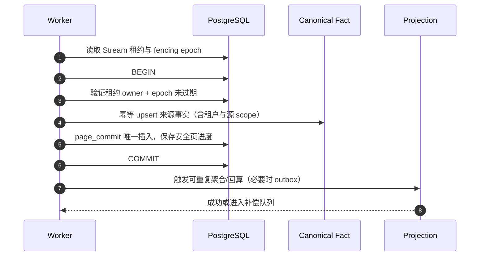
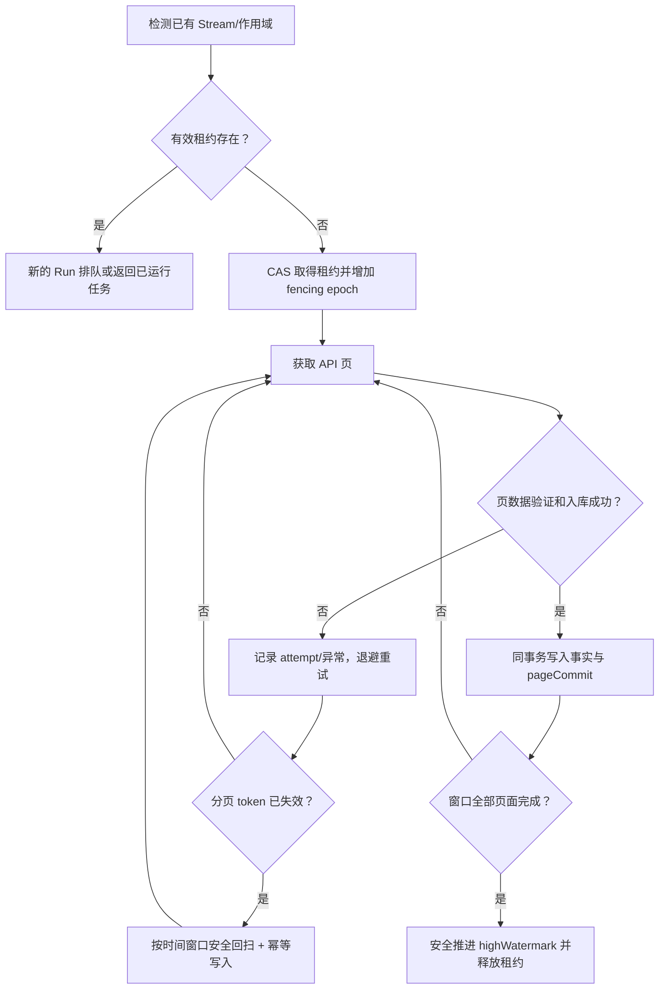

# ARCH-003 · 事务边界、并发控制与一致性校验

**G2 Proposed；只描述设计，不包含实现。** 主线：平台订单、库存、财务的三个来源事实表，分别保证可重放；聚合投影为衍生、可重新构建。

## 1. 事务边界图

**强约束**：业务数据和 page commit 在同一事务内提交是首选；如果因跨库而无法同事务，必须先提交事实、再推进游标，依赖幂等重放完成补偿。投影更新失败不能丢掉事实。

## 2. 各实体允许的更新方式

| 对象 | 数据来源 | 更新原则 | 并发冲突 |
|---|---|---|---|
| Seller / Marketplace 连接 | 管理员 + Amazon 认证 | 记录状态变更与审计 | 版本号乐观锁 |
| Listing 当前视图 | SP-API | 来源更新时点与有效源版本比较 | 较旧记录不能覆盖较新 |
| Listing SKU 映射历史 | 人工确认 | 追加版本/关闭旧有效期 | 同一期间不可并存两条 ACTIVE |
| 订单当前视图 | Orders API | 以来源版本与状态规则决定是否更新 | 乱序通知不得回退状态 |
| FBA 观测 | FBA Inventory API | 每次来源观测记录，更新当前投影 | 同一观测重放不能增库存 |
| 财务交易 | Finances API | 追加事实、保留更正/冲销 | 无可靠来源 ID 的记录不强行合并 |
| 商品历史成本 | 财务人员 | 版本化有效区间，不静默覆盖 | 重叠区间/并发版本冲突 |
| Sync Stream | Worker 持久任务 | CAS lease epoch + 稳定 highWatermark | 失去租约不能推进 |
| Margin / inventory projection | ERP 派生 | 有版本且可重算、重建 | 记录计算版本及输入水位 |

## 3. 保证级别和失败恢复

- 同步对外 API 通常只提供至少一次获取/重试机会；ERP 的目标是**至少一次获取 + 幂等写入的逻辑精确一次效果**，不能承诺平台实际 exactly-once delivery。
- 领域事实入库事务是强一致；跨模块聚合可最终一致，但必须暴露 `calculatedAt` 和 `inputWatermark`。
- Store → Projection 更新要能够全量重算或按有界范围重建，结果含 `calculationVersion`、关联成本版本与源交易 ID。
- Redis 缓存不是身份真相或 Sync 唯一游标；缓存失效重建不应导致经济事实丢失。
- 删改订单/财务来源历史必须受到审计与保留约束，不能用“解决差异”为由修改源数据。
- 租户/账号作用域验证贯穿 Worker 执行，后台任务不能因为由系统账号运行就忽略租户隔离。

## 4. 多页同步与并发竞争

时间窗口 overlap 大小由操作实际返回字段与延迟分布决定，**不先假设所有 API 支持 updated-after**。不同操作（Orders、Finances、FBA）分别实现接口适配的同步策略。

## 5. 必须增加的故障注入

1. Worker A 事务提交后崩溃、未响应上游；Worker B 恢复任务不能重复累计收入/库存。
2. Worker A 租约失效后继续运行，必须因 epoch 不一致而拒绝写入已过期进度。
3. 先到退款、后到订单，匹配后结果重算仍不会双扣。
4. 订单与财务事件同步成功但利润投影失败，页面显示 STALE，投影可补偿。
5. 同一来源财务记录无稳定 ID 且金额/时间碰撞：不能自动合并，保留两条待人工决策。
6. 更新商品成本的同时订单报表读取：必须通过快照/计算版本解释结果。
7. 同一外部 Seller SKU 在两个租户出现：唯一键不能导致跨租户冲突。
8. 索引/数据库约束检查存在失效映射或跨租户外键，数据库本身应拒绝。

详细验收见 [G2-QA](../requirements/g2-architecture-acceptance.md)。数据实体见 [DATA-003](physical-data-design.md)。
