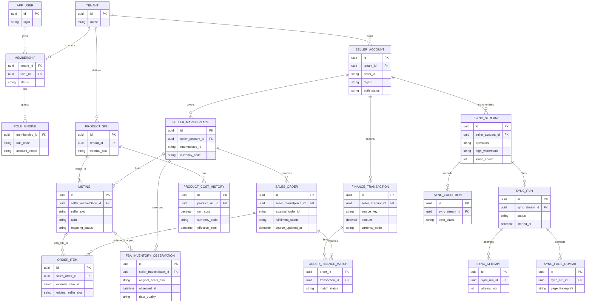

# DATA-001 · 概念 ER 图与数据字典（第二轮修订）

**状态：Proposed，非正式物理 DDL。** 本轮明确租户成员、多账务来源、库存无映射、同步流与运行任务的关系；需在 G2 评审后才可转为 Flyway 迁移。

## 1. 概念实体关系（不是最终外键设计）

## 2. 标识与作用域契约

| 实体 | 关键事实 | 唯一约束建议 |
|---|---|---|
| membership | 同一用户可属于多个租户 | tenant_id + user_id |
| seller_account | 卖家主体及 API region | tenant_id + seller_id + region（需与实际授权关系核验） |
| seller_marketplace | 卖家账户的 Marketplace | seller_account_id + marketplace_id |
| product_sku | ERP 自建 SKU | tenant_id + internal_sku |
| listing | 卖家指定 Marketplace 上的 Seller SKU | seller_marketplace_id + seller_sku + 有效期/版本策略 |
| sales_order | 平台订单与站点来源 | tenant_id + seller_marketplace_id + external_order_id（需与官方唯一范围核验） |
| order_item | 订单项平台标识 | sales_order_id + external_item_id |
| fba_inventory_observation | 时点及字段分桶 | sourceScope + seller_sku + condition/disposition + observed_at + source_observation_key |
| finance_transaction | 平台金额事件 | sourceScope + verified source ID；无 ID 进入待判定池 |
| sync_stream | 多次运行共享高水位 | tenant/account + operation + marketplaceScope + version + filter fingerprint |
| sync_run | 单次运行 | sync_stream_id + run_id |

*不是每条平台记录都有可可靠保证唯一的 transaction ID；必须确认实际字段后决定约束与合成键。*

## 3. 原始事实先于业务映射

- FBA 观测与订单行必须先保存 **source account/marketplace/seller SKU/ASIN(可用时)** 等来源字段。
- `LISTING`/内部 SKU 是可选业务关联，映射缺失不能拒收事实；后续人工修复可重算投影，但保留历史映射版本。
- 财务事件可与多个订单/行存在复杂关联，也可完全没有可用订单关联；`ORDER_FINANCE_MATCH` 保存证据、状态和匹配规则版本，不强制一对一。
- **ERP 订单事实、库存快照、财务交易分别保存**，汇总由独立可重建投影生成，不互相覆盖。

## 4. 存储数据类型和安全边界

- 内部主键 UUID，所有业务数据物理表补 `tenant_id`；与租户相关的 FK/查询/索引由 G2 评审确定。
- 金额 `NUMERIC(20,6)` 示例 + ISO 4217 币种；确定各聚合舍入规则后建立计算单元测试。
- 时间按 UTC `TIMESTAMPTZ`，UI 显示站点/用户本地时间；不要用本地时间作为外部 API 水位。
- 事实审计最小字段：`source_api`、`source_version`、`source_record_key`、`source_updated_at`、`ingested_at`、`quality_status`、`mapping_version`。
- 不默认存买家 PII 或整包 API payload。敏感凭证单独加密保存，不在通用实体表中回显。

## 5. 后续详细图纸

- 物理 ERD/外键索引/RLS、有效期排斥约束与历史数据更正方案。
- 流与运行租约的事务图，财务 event ID 真实性及更正/分配结构。
- 依据已确认 Amazon 站点和脱敏样本完成唯一键碰撞评估。

关联：[DOM-001](domain-state-model.md)、[DATA-002](source-reconciliation.md)、[SYNC-002](sync-stream-contract.md)、[IAM-001](tenant-bootstrap.md)。
