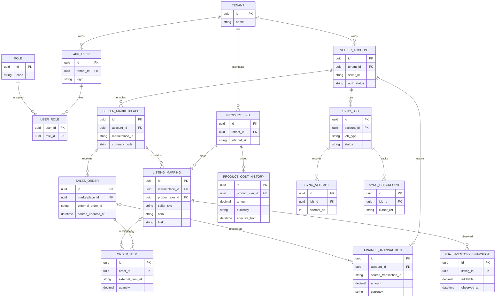

# DATA-001 · 概念 ER 图与数据字典

**状态：概念设计（未实施、非最终 DDL）。** 所有表字段和约束在首次迁移 PR 中经评审后落地。

## 1. 领域 ER 图（核心关系）

图中省略了部分租户与审计字段，以突出主要关系；物理表必须补齐 `tenant_id` 和租户安全约束。`ROLE` 可为全局角色模板或租户级角色，见 ADR-0002。

## 2. 数据字典（首批关键字段）

| 实体 | 字段 | 类型建议 | 规则 |
|---|---|---|---|
| seller_account | tenant_id, seller_id, region, status | UUID, VARCHAR | 唯一键 tenant_id + seller_id + region |
| seller_marketplace | seller_account_id, marketplace_id, currency_code | UUID, VARCHAR(16), CHAR(3) | 账号+站点唯一；保留 API 区域 |
| product_sku | tenant_id, internal_sku, name | UUID, VARCHAR | 同租户内部 SKU 唯一 |
| listing_mapping | seller_marketplace_id, seller_sku, asin, fnsku | UUID, VARCHAR | 账号+站点+seller_sku 唯一，不强制 ASIN 唯一 |
| sales_order | tenant_id, seller_marketplace_id, external_order_id | UUID, VARCHAR | 按租户+来源账号/站点+订单号去重 |
| order_item | sales_order_id, external_item_id, qty | UUID, VARCHAR, NUMERIC | 按订单+平台行 ID 去重 |
| fba_inventory_snapshot | listing_id, observed_at, status buckets | UUID, TIMESTAMPTZ, INTEGER | 每次观测独立记录，保留抓取时间 |
| product_cost_history | sku_id, effective_from/to, amount, currency | UUID, TIMESTAMPTZ, NUMERIC, CHAR(3) | 有效区间不应相互冲突 |
| finance_transaction | source_id, amount, currency, occurred_at, posted_at | VARCHAR, NUMERIC(20,6), CHAR(3), TIMESTAMPTZ | 必须包含源作用域与事件类别 |
| sync_checkpoint | scope, high_watermark, cursor, updated_at | JSONB / VARCHAR / TIMESTAMPTZ | 游标失效需要可回退时间窗口 |

## 3. 设计约束

- 主键建议 UUID，平台外部标识作为业务键，永不直接作为全局主键。
- 所有时间保留 UTC TIMESTAMPTZ，UI 根据 Marketplace 或用户时区展示。
- 金额采用定点 NUMERIC，原币种必须保存；汇率/舍入逻辑可重复计算。
- 保留 `source_system`、`source_record_id`、`source_updated_at`、`ingested_at` 与 `mapping_version`，便于追踪。
- 金额流水采用新增与更正/冲销事件；不得直接覆盖历史财务事实。
- 账号解绑不应立即破坏业务历史；脱敏、删除、保留须遵循数据保护要求。

## 4. 下一版详细图纸

物理 ERD（主外键、索引、软删除）、状态图、历史快照索引方案、审计事件结构、迁移回退设计，均需真实需求确认后定稿。见 [图纸索引](../diagrams/index.md)。
