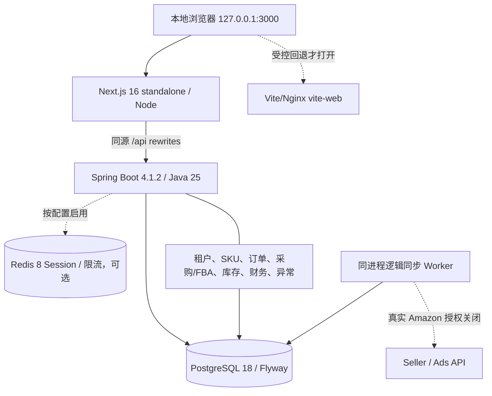
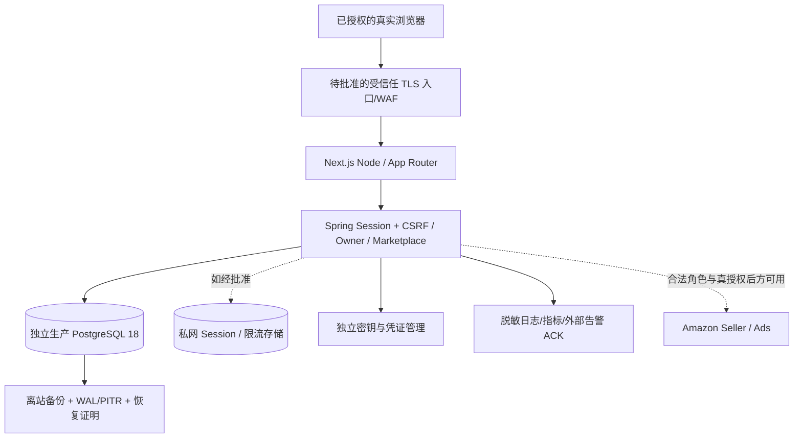

# DEP-001 · 部署架构与信任边界

> **当前部署技术基线：2026-11-21 / V191**。默认 `web` 为 React 19 / Next.js 16 standalone Node，Node 24 + pnpm 12.20.0 构建。Vite/Nginx 仅显式回退或 GitHub Pages 虚构展示；旧“Web UI / Nginx”默认拓扑不再适用。生产 [#104](https://github.com/kunlong-luo/merchivra/issues/104) 仍 NO-GO。

## 本地真实代码拓扑

本地 `deploy/compose.yaml` 默认启动 `postgres + server + web`，仅回环绑定；已有 spark-db PostgreSQL 18 时只启动 `server + web`。Next 私有 `/api` 反向代理转发至 Spring；后端私有 `/actuator/health` 不得通过公开 Web 暴露。Next 健康检测不仅验证代理 Ping 的 Spring 身份，还需验证私有 PG18 Actuator UP。Vite 回退服务 `vite-web` 只有明确启用 `vite-fallback` profile 才启动。

## 生产参考拓扑：方案，不是已部署

这是**目标安全架构候选**：真实 TLS/转发头、KMS/密钥、恶意文件扫描、RPO/RTO/PITR、外部 Alertmanager ACK、恢复/回滚、合法 Amazon 角色和 G1/G2/G3 业务签署均须提供独立目标证据；**不接受合成 A3/Pages/Mock 充当生产准入**。

## 环境与责任

| 环境 | 数据与网络 | 结果含义 |
| --- | --- | --- |
| Local / synthetic | PostgreSQL 18 + 本地 Node/Spring；Mock/人工未核验来源 | 可回归的工程行为，非真实平台事实 |
| Isolated A3 | Disposable PG18/Flyway、HTTP、Chromium、受控 HTTPS 切流 | 精确 SHA 的技术验收，不是真实 Amazon 或 G1/会计净利润核证 |
| Target candidate | 操作员单独配置 TLS/数据库/密钥/备份/告警与审批 | 待独立签署，不能依赖 `compose.production.yaml` 就开放公网 |
| Production | 只有 G1/G2/G3 和外部证据全部完成才可考虑 | 当前明确 **NO-GO** |

[当前状态](../current-status.md) · [实际 Compose 部署与卸载](../deployment/local-spark-db.md) · [发布门禁](../testing/release-readiness-v68.md) · [运维原则](../ops/operations.md)。
