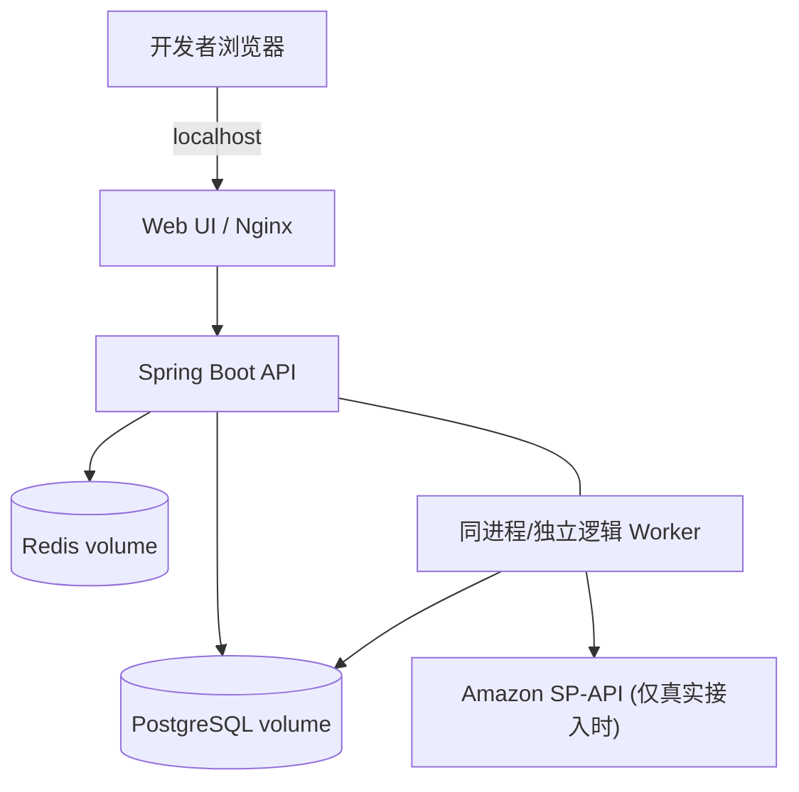
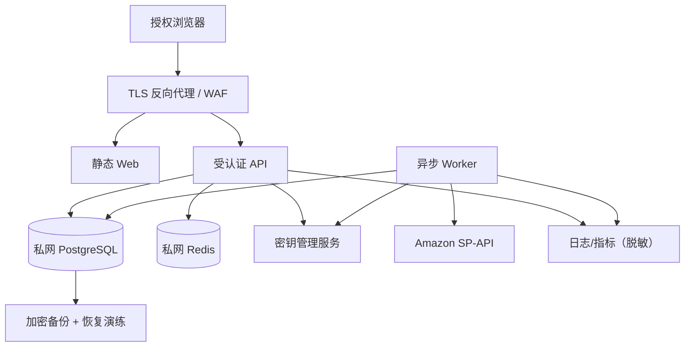

# DEP-001 · 部署架构与信任边界

## 开发/本地部署拓扑

开发端口默认绑定 `127.0.0.1`，本地没有账户授权模块完成前不对公网开放。

## 生产参考拓扑（非可立即部署配置）

**硬性边界**：数据库不应公网可达；应用必须受 TLS、会话认证及租户授权保护；生产密钥不放仓库；监控不得采集 PII/Refresh Token。

## 配置矩阵

| 环境 | 数据 | Amazon 凭证 | 是否开放公网 |
|---|---|---|---|
| Local Mock | 全虚构 | 不需要 | 否 |
| Integration | 脱敏/官方 Sandbox | 单独保管 | 否 |
| Staging | 最小授权测试数据 | 密钥管理器 | 受控访问 |
| Production | 真实卖家数据 | 专用密钥管理器 | 完成认证/安全审查后才可 |

## 运维要求

镜像版本不可变、数据库迁移经过审查、备份恢复每次发版前演练、限制数据导出、支持凭证吊销/轮换、健康检查和任务积压告警。详见 [运维方案](../ops/operations.md)。
