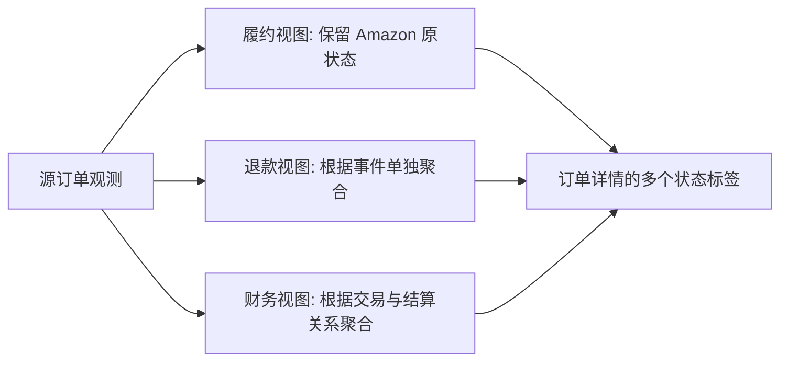

# DOM-001 · 跨模块业务状态与不变量

**状态：Proposed（设计修正）**｜对应 FR-ORD-01/03、FR-INV-01、FR-FIN-01、FR-SHOP-01、FR-SYNC-01。业务状态由平台事实决定；ERP 不自行创造 Amazon 订单履约状态。

## 1. 四种必须分开的状态

| 维度 | 事实来源 | 典型值/内部状态 | 错误做法 |
|---|---|---|---|
| 履约状态 | Orders v2026-01-01 的 fulfillment status | PENDING、UNSHIPPED、PARTIALLY_SHIPPED、SHIPPED、CANCELLED、UNFULFILLABLE 等；保留平台原值 | 将 REFUNDED 当作履约状态 |
| 退款状态 | 财务/订单退款事件 | NONE、PARTIAL、FULL、UNKNOWN | 退款一发生就覆盖履约状态 |
| 财务状态 | 平台 posted/released 与结算关联 | NOT_OBSERVED、POSTED、PARTIALLY_RECONCILED、SETTLED、DISPUTED | 订单“已发货”等于“已回款” |
| 同步状态 | ERP 任务引擎 | QUEUED、RUNNING、RETRY_WAIT、PAUSED、FAILED、SUCCEEDED | 用同步成功推导数据一定齐全 |

这些是 **独立维度**。某订单可以同时是 `SHIPPED + PARTIAL_REFUND + POSTED`；后续退款出现不修改其历史发货事实。

## 2. 订单履约与财务正交状态图

**转换规则**：仅根据官方已证实的字段作状态转换；未知状态保存 `rawFulfillmentStatus`，显示 `UNKNOWN` 并触发映射升级，不可自动推断成功/失败。取消与退款可以异步出现。重复/乱序状态以平台更新时间与稳定版本判断，不以本地到达时间覆盖较新事实。

## 3. 商品映射生命周期

`UNMAPPED → SUGGESTED → VERIFIED → ACTIVE`，可通过 `CONFLICT` 进入人工处理；禁用只影响后续自动归属，不破坏历史订单的已确认归属。

- `UNMAPPED`：Listing、订单行和库存原始事实必须仍可保存。
- `VERIFIED`：明确由人工确认或严格规则验证，一条卖家站点 Seller SKU 只能在一段有效时间内关联一个内部 SKU。
- `CONFLICT`：自动策略无法确定内部 SKU 时不得任意合并。
- 订单行保存当时 Seller SKU/ASIN 与映射版本；今后改映射不能静默改写既有历史分析。

## 4. FBA 库存状态

库存没有“退款后就减库存”的固定转换。基于 `seller_account + marketplace + seller_sku + condition/disposition + observed_at` 建立观测事实，映射到内部 SKU 是可选的后续步骤。

- `NO_DATA`（尚无观测）≠ `ZERO`（明确观测到 0）≠ `STALE`（超过评审确定的时效阈值）。
- 保留 `fulfillable`、`inbound`、`reserved`、`unfulfillable`、`researching` 等平台实际支持的桶，字段缺失表示 UNKNOWN 而非 0。
- 不对不同站点、不同状况或不同 SKU 的库存无条件相加；对聚合结果注明维度与时间。

## 5. 外部连接状态

`UNCONFIGURED → AUTHORIZING → CONNECTED`；授权缺失/撤销时进入 `AUTH_REQUIRED`；权限不足 `INSUFFICIENT_ROLE`；暂时性 API 不可用进入 `DEGRADED`，不删除账号历史记录。

只有明确授权失败才要求重新授权；一般的 429 / 5xx 不应误标为 token 被撤销。

## 6. 不变量与反例测试

| 不变量 | 反例 | 对应验收 |
|---|---|---|
| 履约与退款独立 | SHIPPED 后发生退款变为 REFUNDED（错误） | AC-06, AC-18 |
| 事实不靠 SKU 映射才能保存 | 未关联商品导致订单/库存入库失败 | AC-19 |
| 不倒序覆盖 | 较旧订单通知覆盖较新的 API 状态 | AC-20 |
| 库存未知不当作零 | 缺少可售桶显示 0 | AC-08, AC-21 |
| 结算不由订单状态推导 | SHIPPED 自动显示 SETTLED | AC-22 |

详见 [验收标准](../requirements/acceptance.md)、[原始数据与对账模型](source-reconciliation.md)。
