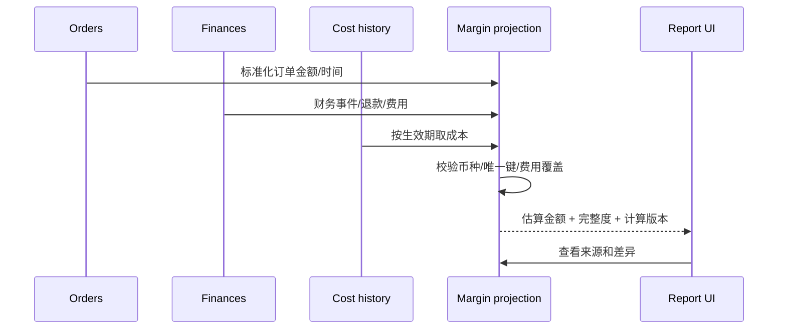

# FIN-001 · 金额、成本、利润与对账口径

**状态：业务口径待卖家/财务负责人确认。** 本文是可实现的草案，不构成会计或税务建议。

## 必须区分的三张视图

1. **订单经营视图**：按订单/行的销售发生时间估算经营收益，可能尚未发生最终费用。
2. **平台财务交易视图**：按财务事件发生/入账时间记录销售收入、费用、赔偿、退款及其他调整。
3. **结算视图**：平台结算批次/可用资金/回款，不等同销售额；与财务事件核对。

## 估算模型 v0.1

`预估贡献毛利 = 订单商品收入 + 可归属运费收入 - 退款和折扣 - 已知平台交易费用 - 商品成本 - 已知履约费用`

- 可归属税金、汇率损益、广告、仓储、头程、固定支出等，分别列为「已计入 / 未计入 / 待分类」。
- 把「未取得数据」标记为 `UNKNOWN` / `INCOMPLETE`，**不能按 0 处理**。
- 商品成本 = 对应期间有效单位成本 × 数量；多币种换算需指定汇率日期与来源。
- 费用若发生在订单之外，通过可审计的分配规则关联 SKU 或留在「未分配费用」。
- 计算输出保存 `calculation_version`、`cost_version`、`fx_rate_id`、`source_event_ids` 和 `completeness_status`。

## 示例（虚构美元订单）

| 项目 | 金额 USD | 说明 |
|---|---:|---|
| 商品收入 | 40.00 | 不含代收代缴税金的示意口径 |
| 退款/折扣 | -2.00 | 已知且可归属 |
| 平台交易费用 | -6.00 | 已知 |
| 履约费用 | -4.00 | 已知 |
| 商品成本 | -13.00 | 有效成本版本 |
| **预估贡献毛利** | **15.00** | *不含广告、仓储、头程、固定费用、税务等* |

如广告费用未知，应展示「15.00 USD（部分费用未计）」而不是「净利润 15.00 USD」。

## 事件对账流程

## 需要业务确认

是否按订单行还是 SKU/日分配费用？价格含税与税费代收区别？Amazon 促销、退款、FBA 配送费与仓储费的处理？广告归因窗口？汇率采用订单日、月末或结算日？完整会计核算不属于 MVP。
