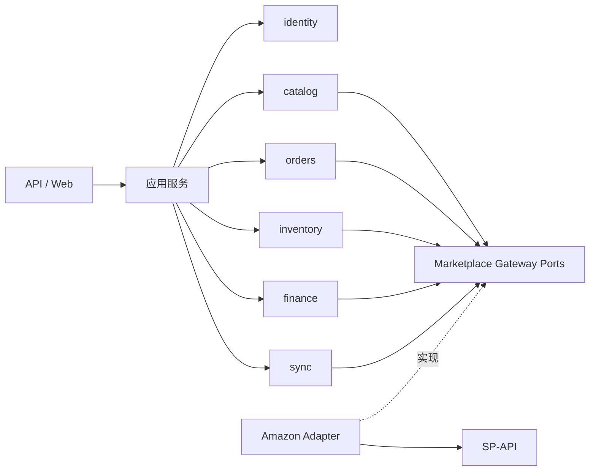

# ARCH-002 · 模块职责与依赖规则

| 模块 | 负责 | 不应该负责 |
|---|---|---|
| identity | 租户、用户、权限、审计主体 | 商品或订单的业务规则 |
| marketplace | Seller 连接、Marketplace、接口权限状态 | 订单的价格/利润逻辑 |
| catalog | 内部 SKU、商品与 Listing 关系 | 平台 HTTP 细节 |
| orders | 订单事实、订单项、状态与退款关联 | 财务收入认列或库存扣减的猜测 |
| inventory | 仓库库存与 FBA 快照视图 | 用快照写入仓库出入库流水 |
| finance | 成本有效期、财务交易、利润口径 | 把未完整数据宣传为净利润 |
| sync | 任务、检查点、重试、限流、监控 | 修改业务含义 |
| adapters | Amazon 接口 DTO/鉴权/标准化 | 存储领域规则与 UI 页面 |

箭头为逻辑使用关系而非允许任意循环依赖；`identity` 的上下文策略跨模块复用但不开放修改租户权限的入口。

## API 契约（单一事实来源）

具体端点、权限、幂等键、分页、金额类型、错误码以 [API-001](api-contracts.md) 为准。本页只负责模块职责与依赖原则，不再重复维护容易漂移的资源路径表。

服务端从可信身份取得 tenant 上下文；创建同步任务统一走 `/api/v1/sync-runs`（设计约定），与持久 `sync_stream` 区分。同步 Worker 和 API 不能绕过租户范围。

## 模块解耦验收

对适配器依赖只允许从 Ports 层访问；禁止领域模块互相引用数据库表作为隐式接口；跨模块事务与事件发布策略需配套 ADR。
