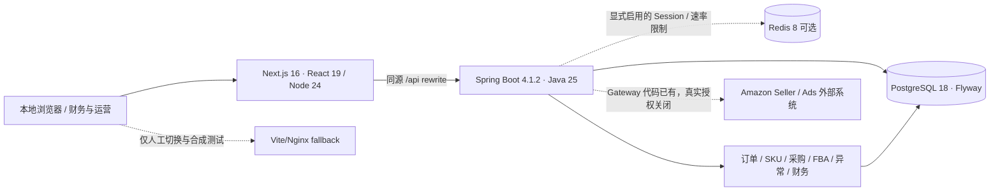

# ARCH-001 · Merchivra 当前系统架构

> **代码事实基线：2026-11-21 / V191。** 已实现的是以 Spring Boot 为中心的**模块化单体**、PostgreSQL 18 和 Next.js 16 本地 App Router；跨进程 Worker、对象存储或真实 Amazon 接入不应因概念图而被宣称已在生产运行。外部 G1/G2/G3 仍未签署，生产 [#104](https://github.com/kunlong-luo/merchivra/issues/104) NO-GO。参见 [当前状态](../current-status.md) 和 [现行 P0](../roadmap/current-plan.md)。

## 1. 系统边界

默认 `deploy/compose.yaml` 有 `postgres + server + web` 三个容器；复用 spark-db 的 `compose.spark-db.yaml` 只启动 `server + web`，独立数据库角色/库由操作员事先手动建好。二者默认 `web` **都是 Next.js Node**，端口绑定 `127.0.0.1:3000`；后端 API 为本地 8080。Vite/Nginx 通过 opt-in `vite-web` profile（3002）或 `pnpm dev:vite`（5173）保留受控回退。公开 Pages 静态虚构展示与认证业务是两条不同链路。

## 2. 技术选型（按代码而非历史候选图）

| 范围 | 已采用 |
| --- | --- |
| JVM/服务 | Java 25、Gradle Wrapper、Spring Boot 4.1.2、Spring Security Session/CSRF、Springdoc/OpenAPI |
| 数据 | PostgreSQL 18、Flyway 只前进迁移、租户/Marketplace 约束、不变审计；Redis 8 可选 |
| Web | Next.js 16.4.5 App Router、React 19、TypeScript 6、Node 24、**pnpm 12.20.0** |
| 表格/客户端 | TanStack Query/Table、Orval、Zod、Base UI；原币和 UNKNOWN/Mock 状态不混淆 |
| 部署/验收 | 本地 Docker Compose、Next Node standalone、PG18/HTTP/Chromium/A3；无自动公网发布 |
| 不再采用 | Vue、Maven、PostgreSQL 17、以 Vite 为默认 ERP 的方案 |

`apps/web/pnpm-lock.yaml` 是唯一 JS 锁文件；GitHub Actions 使用 pnpm 冻结安装。Amazon SP-API SDK/Mock Gateway 代码存在**不代表**真实卖家已授权，Ads 与 Seller 各自有独立权限边界。

## 3. 领域与安全不变量

- **租户/Marketplace**：服务器端 Session/CSRF、Owner/工作人员权限及数据库作用域为准，不能依赖隐藏前端按钮。
- **财务**：按源报告/结算行保存原始身份、SHA-256、原币六位精度；V91/V92/V94/V95/V102 的独立复核和重复来源 hold 不可被同金额/同摘要绕过。
- **利润**：V64 已知范围贡献 ≠ V162 全成本；V185–V188 原币敏感度与整期阻断不自动生成已核验净利润或 GL 入账。
- **库存/WMS**：内部签名、密钥挑战和三人 QC 不能自行认证外部运营商身份或物理实收；G1 未批准不得改库存/COGS。
- **同步**：同步游标、幂等、审计和租约由持久化数据守护；缓存不可作为唯一事实；当前真实 Amazon API 入口默认保持关闭。
- **代理**：Next `/api/:path*` 转发到私有 Spring，`/actuator/health` 不经公网 Next rewrite；Next 健康检查同时核实 Spring Ping 身份与内部 PG18 Actuator 状态。

## 4. 设计与实现参考

[领域状态](domain-state-model.md) · [实体关系](data-model.md) · [数据来源对账](source-reconciliation.md) · [一致性与事务](consistency-boundaries.md) · [模块划分](modules.md) · [API 契约](../api/README.md) · [G1/G2 业务/架构准入](../governance/decision-register.md) · [V188 原币利润预览](../finance/v188-period-profit-cost-waterfall-preview.md)。

上游 ADR 与 G1/G2 的早期提案可作为设计来源，但只有在当前代码与正式独立签署一致时才成为发布条件，不以合成 CI 自动替代签署。
