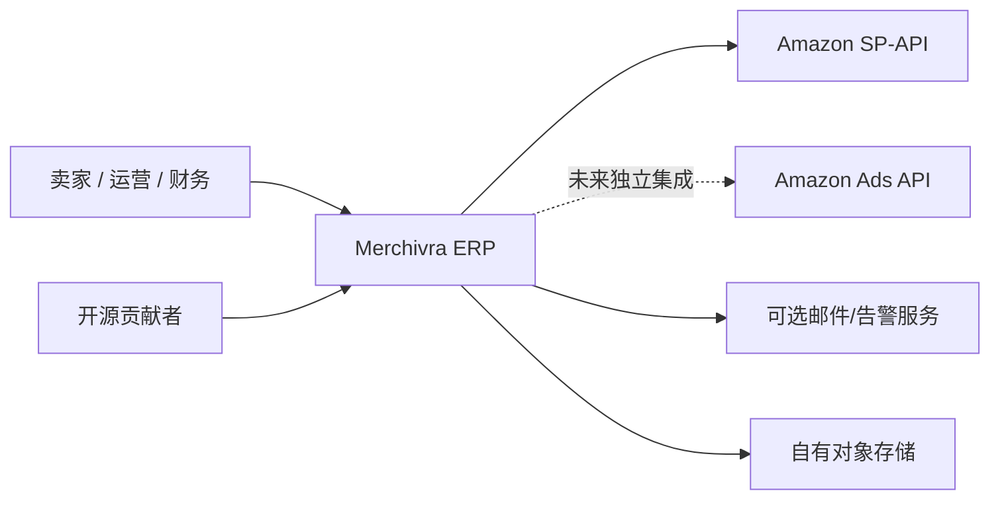
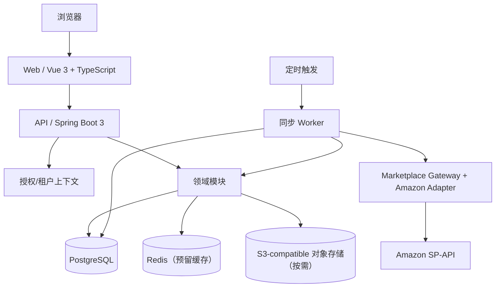

# ARCH-001 · 系统总体架构（C4 思路）

**状态：Proposed**｜架构风格：模块化单体 + 异步任务 Worker（逻辑分离、初期可同一进程/部署）

## 1. 系统上下文（C4 / L1）

范围：卖家拥有 Merchivra 的运行环境；Amazon 是第三方数据系统；Ads API 不是 SP-API 自动授权能力。

## 2. 容器图（C4 / L2）

将同步 Worker 视为单独的逻辑运行单元；MVP 可与 API 共享同一 Spring Boot 工程与数据库，不预设 Kubernetes 或 RabbitMQ。

## 3. 约束与边界

- 技术候选：Java 21、Spring Boot、Maven、PostgreSQL、Flyway、Vue 3/TypeScript/Vite、Docker Compose。
- 领域模型不可直接依赖 Amazon HTTP DTO，必须经过适配器标准化。
- Controller 只做协议与输入验证；应用服务编排；领域处理规则；存储层落实租户与事务约束。
- 命令/查询分离是代码组织原则而非必须实现 CQRS 基建。
- 交易事实与同步 Checkpoint 必须有持久化策略；短期缓存不可作为唯一真相来源。
- 不接受明文生产凭证或客户敏感数据写入仓库/CI。

## 4. API 边界

前端 API 默认 `/api/v1`（规划约定）；UI 不直接调用 Amazon；后台任务不得绕过授权和租户过滤。具体资源/错误契约见 [模块边界](modules.md)。

## 5. 关键架构决策

- [ADR-0001 模块化单体](adrs/0001-modular-monolith.md)
- [ADR-0002 多租户模型](adrs/0002-tenancy.md)
- [ADR-0003 事件与财务账本](adrs/0003-finance-ledger.md)

详细数据关系见 [ER 图](data-model.md)，同步机制见 [同步引擎](sync-engine.md)，网络部署见 [部署图](deployment.md)。
