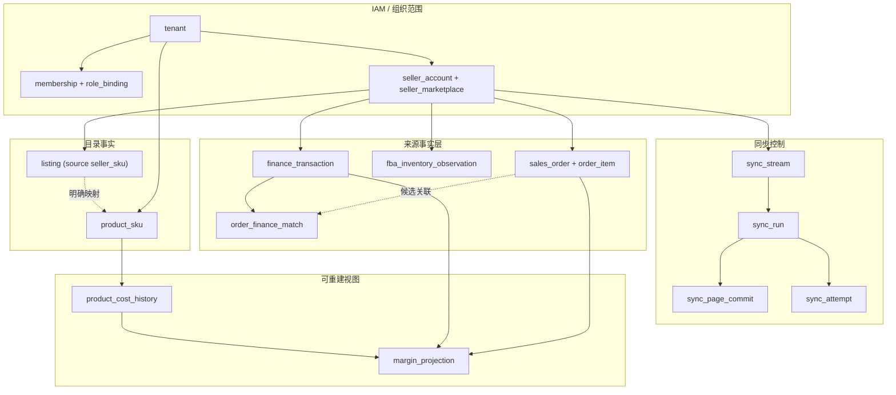

# DATA-003 · PostgreSQL 物理数据模型（G2 候选）

**版本 0.1 / Proposed / 未批准**。面向 PostgreSQL 的**约束级设计**，非可立即执行生产迁移。目标首发 US/NA、FBA 库存优先，**不把未签署的 G1 假设固化为数据库限制**。

本轮设计审查对应 [REVIEW-004](../governance/g2-review-2026-10-30.md)、[G2-QA-001](../requirements/g2-architecture-acceptance.md)；**仅有 SQL 片段作为约束说明，并无迁移文件**。

## 1. 数据分层与边界




非可信外部平台字段先标准化再写入事实表。业务查询投影可以重算，持久原始业务 ID、金额和校验来源不可被重算覆盖。

## 2. 建议实体数据字典（第一版字段级）

| 表 | 强制关键字段（省略通用 created_at/updated_at） | 主要索引/约束 | 所有权 |
|---|---|---|---|
| `tenant` | id UUID, name, status | PK(id) | IAM |
| `app_user` | id UUID, login, password_hash/identity_ref, status | PK, login 唯一策略另定 | IAM |
| `membership` | tenant_id, user_id, status | PK(tenant_id,user_id), 双向外键 | IAM |
| `role_binding` | id, tenant_id, user_id, role_code, seller_account_id nullable | FK(tenant_id,user_id), 账号作用域同 tenant | IAM |
| `seller_account` | id, tenant_id, seller_id, region, connection_status, credential_ref | UNIQUE(tenant_id,seller_id,region)，credential_ref 只存引用 | Marketplace |
| `seller_marketplace` | id, tenant_id, account_id, marketplace_id, currency_code, timezone | UNIQUE(tenant_id,account_id,marketplace_id) | Marketplace |
| `product_sku` | id, tenant_id, internal_sku, name, status | UNIQUE(tenant_id,internal_sku) | Catalog |
| `listing` | id, tenant_id, seller_marketplace_id, seller_sku, asin nullable, fnsku nullable, source_updated_at | UNIQUE(tenant_id,seller_marketplace_id,seller_sku)（历史另表） | Catalog |
| `listing_sku_mapping` | id, tenant_id, listing_id, product_sku_id nullable, status, valid_from, valid_to, mapping_version, actor_id | 排斥同一 Listing 的有效期重叠，经审批/更正记录 | Catalog |
| `sales_order` | id, tenant_id, seller_marketplace_id, external_order_id, fulfillment_status_raw, order_time, source_updated_at, source_hash | UNIQUE(tenant_id,seller_marketplace_id,external_order_id) | Orders |
| `order_item` | id, tenant_id, sales_order_id, external_item_id, seller_sku_raw, quantity, amount, currency | UNIQUE(tenant_id,sales_order_id,external_item_id) | Orders |
| `fba_inventory_observation` | id, tenant_id, seller_marketplace_id, seller_sku_raw, fnsku nullable, condition, disposition, observed_at, ingested_at, fulfillable nullable, reserved nullable, source_observation_key, quality | 观测 ID/批次键去重；数值允许 NULL（未知） | Inventory |
| `product_cost_history` | id, tenant_id, product_sku_id, unit_cost, currency, valid_from, valid_to, revision, reason | 同 SKU/成本类型有效区间排斥重叠 | Finance |
| `finance_transaction` | id, tenant_id, seller_account_id, marketplace_id nullable, source_operation, source_record_key nullable, source_payload_hash, transaction_type, posted_at, amount, currency, reconciliation_state | **仅确认为稳定的来源 ID 允许 UNIQUE**；无 ID 进入待辨重记录 | Finance |
| `order_finance_match` | id, tenant_id, sales_order_id nullable, finance_transaction_id, evidence_json, status, rule_version, reviewer_id | 有证据才建立归属；允许多笔关联与待审 | Finance |
| `sync_stream` | id, tenant_id, seller_account_id, operation, api_version, scope_fingerprint, high_watermark, lease_epoch, lease_expires_at | UNIQUE(tenant_id,account,operation,api_version,scope_fingerprint) | Sync |
| `sync_run` | id, tenant_id, stream_id, trigger, status, started_at, finished_at | FK 到同租户 Stream | Sync |
| `sync_attempt` | id, tenant_id, run_id, attempt_no, retry_at, error_class, sanitized_error | UNIQUE(run_id, attempt_no) | Sync |
| `sync_page_commit` | id, tenant_id, run_id, page_fingerprint, committed_at, record_count | UNIQUE(run_id,page_fingerprint) | Sync |
| `sync_exception` | id, tenant_id, stream_id, source_record_key nullable, error_class, disposition | 可人工重试，原敏感 payload 不直接展示 | Sync |
| `audit_log` | id, tenant_id, actor_id, action, object_type, object_id, occurred_at, sanitized_diff | 追加审计，不允许业务普通用户覆盖 | IAM |

**留待专项设计**：退款细分/调整事件表、settlement 关联、FX 利率表与利润投影；先用逻辑字段与来源记录建模，待业务账例和真实 Finances 响应确认后再定 DDL。

## 3. 多租户防串表约束

- 所有业务事实表具有 `tenant_id NOT NULL`，双侧关联使用**同租户复合外键**（例如 `(tenant_id, seller_marketplace_id)` 指向 `seller_marketplace(tenant_id,id)`）。
- 每个被复合外键引用的目标须存在 UNIQUE(tenant_id,id) 或相应匹配键；单独 UUID PK 不足以支持复合引用。
- `role_binding` 指定的 `seller_account_id` 必须属于同 tenant；通过复合 FK 保证，不仅靠服务层过滤。
- 可选 PostgreSQL RLS 是**纵深防御**；若使用连接池，必须通过事务作用域设置租户上下文并防止上下文串请求/泄露，不能把 RLS 当成权限的唯一控制。
- 外部 ID 的去重键须纳入租户 + 平台账户/Marketplace/operation 的**实际唯一范围**；Finances 无稳定来源 ID 时不可假设唯一。

### 示例约束（说明性 SQL，非生产 DDL）

```sql
-- Conceptual only; table definitions, migrations and ownership review required.
ALTER TABLE seller_marketplace
  ADD CONSTRAINT seller_marketplace_tenant_id_id_uq UNIQUE (tenant_id, id);

ALTER TABLE sales_order
  ADD CONSTRAINT sales_order_marketplace_fk
  FOREIGN KEY (tenant_id, seller_marketplace_id)
  REFERENCES seller_marketplace (tenant_id, id);

CREATE UNIQUE INDEX sales_order_source_uq
  ON sales_order (tenant_id, seller_marketplace_id, external_order_id);

-- A NULL value means "not observed", not zero units.
-- CHECK (fulfillable IS NULL OR fulfillable >= 0)
```

## 4. 金额、时区、零与未知

- 金额 `NUMERIC(20,6)` 作为候选，原币种 `CHAR(3)`；HTTP 中用 string decimal，避免 JS 数值精度问题。
- 成本记录 `valid_from/valid_to` 建议半开区间 `[from,to)`，用 `tstzrange` + exclusion constraint/GiST 防止同 SKU/成本类别有效范围重叠。
- 时间全部保留 UTC `TIMESTAMPTZ`。订单发生、财务 posted、结算、外部 source_updated、ERP ingested 必须有不同字段。
- 库存桶在数据中允许 NULL 与 0：NULL = 没有可确认数字；0 = 来源明确返回零；旧有效快照用于参考，但不得当实时值。
- 建议保留 `source_api`、`source_version`、`source_record_key`、`source_updated_at`、`ingested_at`、`source_hash` 等最小审计字段（避免整包 PII 落库）。

## 5. 物理部署/索引与数据保留

- 所有对外列表默认 `(tenant_id, seller_marketplace_id, source_updated_at DESC, id DESC)` 或对应业务时间复合索引，索引先以查询负载和执行计划验证。
- 财务视图需要 `(tenant_id, seller_account_id, posted_at)`，同步 Stream 需要按 `next_run_at / lease_expires_at` 的任务挑选索引。
- 高容量归档/分区仅在数据规模被确认、备份/迁移策略评审后实施；不猜测 Amazon 数据保留许可。
- 多租户共享 Schema 是 [ADR-0002](adrs/0002-tenancy.md) 的 Proposed 方案，还未获安全负责人签署。

## 6. 迁移与评审准入

第一批 Flyway 迁移需分模块、可从空库应用、带 Testcontainers 集成测试。已发布迁移不修改原文件；更正用新迁移。数据回填必须对来源主键/幂等、批次断点、回滚备份和租户隔离有证明。

### 阻塞清单
DEC-04（租户与账号范围）、DEC-05（Listing 生效映射）、DEC-06/07（成本与退款）、DEC-09（Auth）、DEC-13（Finances ID/权限）及物理唯一性实测。**本设计是审查提案，不代表正式 DDL 或数据库已建立。**

关联：[DATA-001](data-model.md) / [SYNC-002](sync-stream-contract.md) / [DATA-002](source-reconciliation.md) / [G2 评审报告](../governance/g2-review-2026-10-30.md)。
