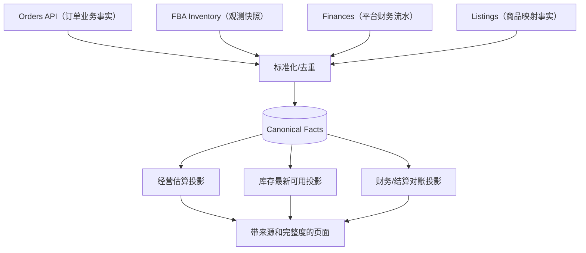
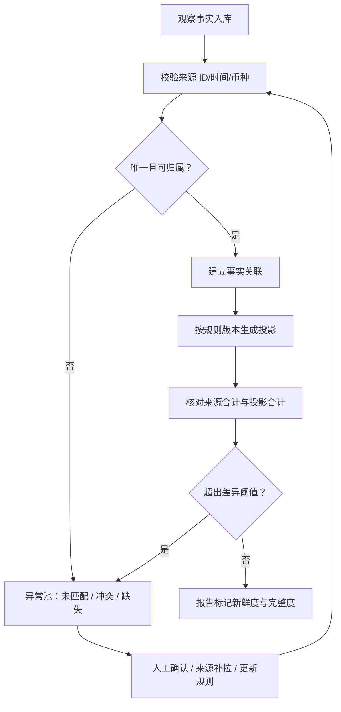

# DATA-002 · 来源事实、聚合优先级与对账闭环

**状态：Proposed**｜原则：数据收集是「事实」，ERP 展示的是「带版本的视图」。不能用多个源的同一金额做重复累计。

## 1. 三层数据模型

1. **Source Observation**：保留必要的外部唯一标识、来源 API/版本、Account/Marketplace、时间戳、字段完整度与脱敏后的原始引用。MVP 尽量存结构化非敏感事实，不默认落整个 API payload。
2. **Canonical Fact**：归一化订单行、Listing、FBA 快照、财务交易，稳定幂等键、时序信息与数据质量状态。
3. **Projection / Reconciliation**：可重新计算的订单视图、库存汇总、预估利润、结算差异，记录来源版本和计算日期。

## 2. 金额优先级：禁止重复计算

| 场景 | 来源优先级 | 展示规则 |
|---|---|---|
| 尚未取得平台财务事件 | Orders 金额可作为 **预计销售额** 基础 | 标记 `PROVISIONAL`，说明来源 |
| 已有匹配到的财务交易 | 对「已入账收入/费用」采用 Finances 事件 | 不再把同笔订单金额与财务事件相加 |
| 财务交易尚未匹配订单 | 保留未分配财务事实 | 不凭空关联错误订单/SKU |
| 财务更正与退款 | 使用源事件标识、发生/入账时间和更正关系 | 不直接覆盖旧金额，支持重新投影 |
| 已有结算标识 | 依据官方可用结算/释放标识建立关联 | 不用订单发货推算到账 |

**可复算公式**：在同一口径/币种下，`已入账贡献额 = 已归类财务收入 - 已归类财务费用 - 商品成本（符合口径时）`；`预估贡献额` 单独计算、不得与已入账相加。详细费用是否计入依据 [FIN-001](finance-model.md) 的已确认分类表。

## 3. 财务匹配顺序

1. 先匹配平台明确提供的 transaction/event ID（仅在该操作提供且在对应作用域内稳定时）。
2. 使用官方 relatedIdentifiers，如订单号、结算组、交易类型等建立**候选关联**。
3. 如果源记录没有保证唯一的 ID，提出具有账户+类型+发生时间+金额+来源行标识的合成键，**先以实测样例验证碰撞风险**；碰撞/歧义必须进入异常队列，不能自动去重或自动认领。
4. 先记录关联证据，再计算费用分摊。跨订单/跨 SKU 费用允许 `UNALLOCATED`。
5. 发现差异时保留两侧原始数据、规则版本与手工确认记录；人工调整以更正/分配事件记录审计，不直接删改原交易。

## 4. 投影完整度

定义 `COMPLETE_KNOWN / PARTIAL / UNAVAILABLE / STALE / DISPUTED`。其中 `COMPLETE_KNOWN` 只表示**明确声明的费用范围内**完整，不意味着全量财务净利润。UI 必须展示已包含与未包含的费用类型。

## 5. 数据处理闭环

校验和差异容忍度需要按业务币种、舍入规则与数据延迟确定，不设统一万能阈值。

## 6. 例子：不能把 Order 40 USD + Finance 38 USD 变成 78 USD

Orders 显示商品收入 40；Finance 已入账收入 38（包含已识别退款 2）。销售经营视图可显示「预计 40」及「已入账 38」两个栏目，必须有口径标签，而不是直接加成 78。若财务流水的 38 实际上已扣费用，必须先拆解事件构成，不能将它当成销售收入与扣费再次重复计算。

## 7. 数据保留

保留非敏感来源事实、外部键、审计链、字段映射版本；避免无必要保存整包可能含 PII 的响应。有关最小化与保留依据 [安全设计](../security/security-design.md) 和 Amazon 许可要求评审。
