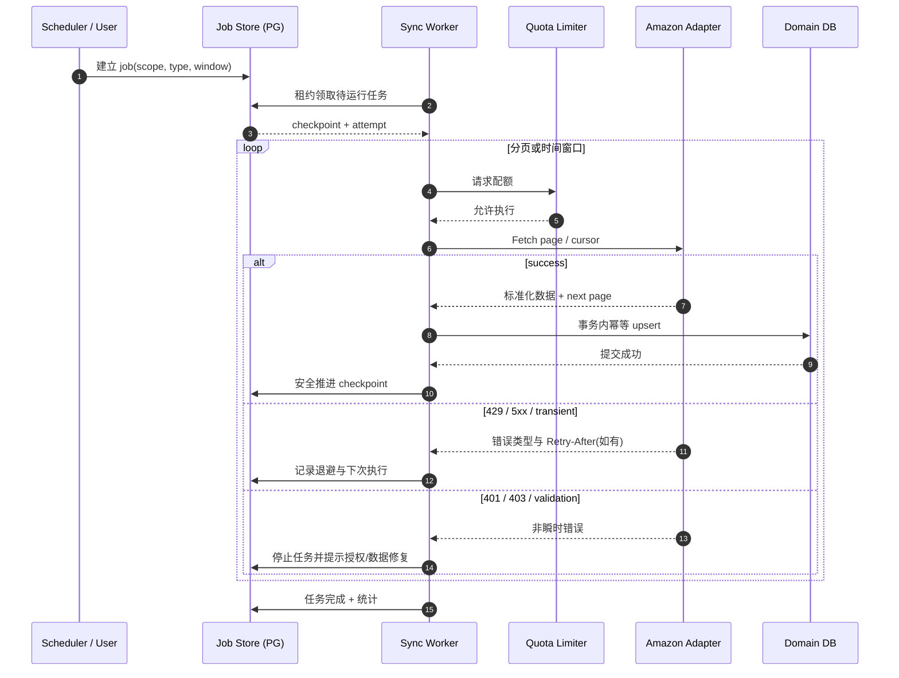
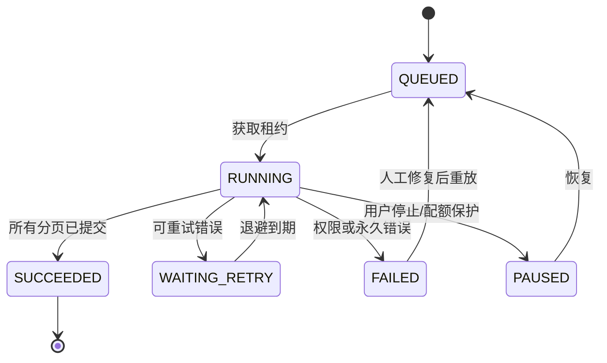

# SYNC-001 · Amazon 数据同步引擎设计

**设计目标：可恢复 + 幂等 + 可观测 + 平台限流友好。** 不依赖具体 Amazon 版本，按接口适配器隔离。

## 1. 时序图

**事务边界**：数据提交后再推进游标，或在同事务内提交数据与检查点；绝不先提交检查点再写业务数据。

## 2. Job 生命周期

## 3. 幂等与回填约束

- 每条业务事件都必须建立稳定幂等键：`tenant + source + account + marketplace + external-id + event-type(如适用)`。
- 支持更新/更正事件；对同一订单采用来源更新时间及有定义的版本选择策略。
- 时间窗口同步采用**有重叠的安全回看区间**，重叠数据依靠幂等去重。
- 分页 Token 可能过期：按该操作版本的文档处理；Token 无效时从最近安全时间点补偿，而非永久放弃。
- 所有 429、5xx、超时与网络重置分类处理，支持指数退避、抖动和操作限流；不硬编码全平台一个固定 QPS。
- 失败任务必须能展示 account/marketplace/operation、脱敏错误、最后成功检查点、重试次数。
- 每次同步记录 sourceUpdatedAt、startedAt、completedAt、recordsSeen/Upserted、lag 与 traceId。

## 4. 特别注意

- 不能把 Amazon 平台通知当作唯一真相来源：通知驱动增量与定期补偿需要配合。
- Finances 的交易发生、发布和结算存在时间差；用独立流水并定期重对账。
- FBA 快照应保存观测时间与数据来源；不能将缺失数据解释为 0。
- 工作队列先采用 PostgreSQL 持久化任务，只有性能瓶颈经测量后再引入消息总线。

## 5. 失败注入验收

同一批数据三次重放；第三页中断；Token 过期；429 限流；401 授权失效；一条非法商品数据；跨租户任务被错误配置；Worker 崩溃后租约回收；竞态同作用域提交。这些测试必须对应 [QA 文档](../requirements/acceptance.md)。
