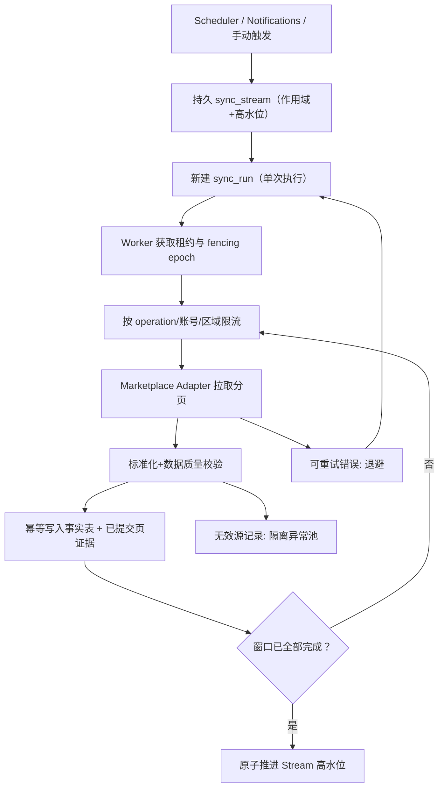
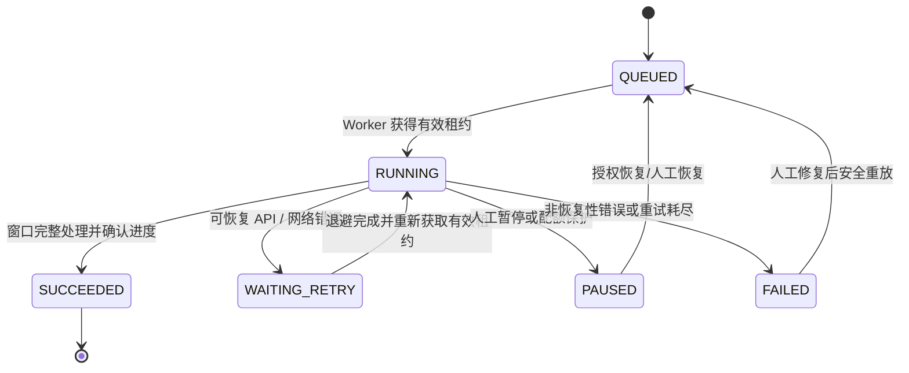

# SYNC-001 · 同步引擎总览（第二轮修订）

**状态：Proposed**。本文件定义架构职责；核心的持久 Stream、Run、Attempt、租约、幂等与检查点协议以 [SYNC-002](sync-stream-contract.md) 为准，禁止使用「每次新建 job 自带独立唯一 checkpoint」代替。

## 1. 总体流程

## 2. 三类状态

- **Connection**：AUTH_REQUIRED / CONNECTED / DEGRADED 等。用于账户授权状态。
- **Stream**：稳定作用域、水位和最新健康状态。
- **Run/Attempt**：单次触发与多次重试记录，状态 QUEUED/RUNNING/WAITING_RETRY/PAUSED/FAILED/SUCCEEDED。

不要将 Amazon 授权失败误归因于暂时限流，也不要因为 Job 成功就断言全部财务数据已齐全。

### Run/Attempt 状态机（图 D-11）

说明：本图是**单次 run/attempt**状态，不是持久 Stream 的高水位状态。不能凭 `SUCCEEDED` 推断外部财务结算已完成。

## 3. 事务不变量

1. 只有持有有效租约的 Worker 可推进 Stream；旧 Worker 恢复后不能提交。
2. 事实写入与进度推进采用同一 DB 事务或先安全提交事实、再推进游标；**绝不反过来**。
3. Orders v2026-01-01 分页 Token 有有效期限制：过期后重建重叠时间窗口，不能永久依赖保存 Token。
4. 一次窗口中的全部分页确认完成后方可推进高水位；空页与结束信号分开判断。
5. 通知只加速发现变化，仍须周期性回扫/补偿、财务重对账。
6. 平台库存快照不是仓储增减事件；不同 API 的水位与速率不可混用。

## 4. 验收入口

[AC-04/05/12/13/23/25](../requirements/acceptance.md) 与 [E2E-06](../testing/end-to-end-scenarios.md) 是最小契约；正式实现必须加入操作级限流、游标过期、漏页、重复、乱序、任务租约/崩溃等失败注入测试。
