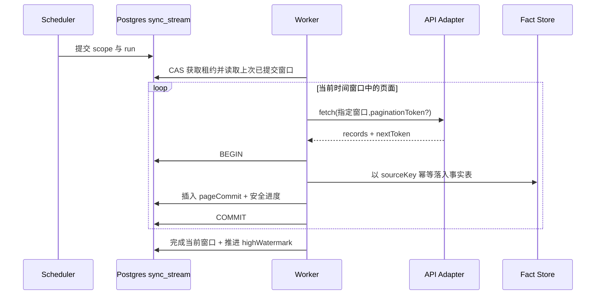

# SYNC-002 · 持久同步流、任务租约与检查点协议

**状态：Proposed**。事务与 Worker fencing 的 G2 进一步设计见 [ARCH-003](consistency-boundaries.md)，迁移前必须审查 [ADR-0004](adrs/0004-durable-sync-and-idempotency.md)。修复旧设计中「检查点只依附一次 job」的问题。同步按固定作用域定义一个持久 Stream，多次任务运行共用该 Stream 的安全水位。

## 1. 逻辑身份

`streamKey = tenantId + sellerAccountId + marketplaceScope + operation + apiVersion + filterFingerprint`；当接口需要账号级而非站点级作用域时使用明确的账户范围标识，不能隐式拼接空 marketplace。

| 资源 | 持久内容 | 更新规则 |
|---|---|---|
| `sync_stream` | streamKey、window/highWatermark、配额维度、状态、lease_owner/expiry | 事务内 compare-and-set；唯一 |
| `sync_run` | runId、streamId、trigger、requested window、started/ended、outcome | 每次触发新增 |
| `sync_attempt` | runId、attemptNo、lastErrorClass、retryAt、requestId | 可重试产生新尝试 |
| `sync_page_commit` | runId、pageFingerprint、recordCount、commitAt、cursor状态 | 与数据写入同一事务或严格先写后推进 |
| `sync_exception` | streamId、source record/operation、category、disposition | 失败隔离并保留人工处理入口 |

分页 Token 是**短期继续请求的句柄，不等于永久高水位**。Orders v2026-01-01 的 `paginationToken` 24 小时有效，不能指望跨天重试永远可用；要保留可重建的时间窗口并有重扫策略。

## 2. 安全推进协议

- 完成一个窗口的**全部**页面后才能推进该窗口高水位；空页并不一定代表窗口已结束，按响应结束信号判断。
- 失去租约/租约过期后，新 Worker 必须校验 fencing token/运行代数，避免旧 Worker 在恢复后覆盖新结果。
- 异常期间仅允许已验证为安全的重试操作；非幂等平台写入不在 MVP。
- 分页过期：丢弃旧 token，重建有重叠的更新窗口，再做幂等写入。
- 任务可以 CANCEL/PAUSE，但不可抹除 stream 上的已确认进度和失败证据。

## 3. 验收

| 场景 | 预期 |
|---|---|
| 每天创建一个新 run | 继续同一 stream 的高水位，不从 0 全量重复 |
| 第 3 页数据提交后进程崩溃 | 重启后可以安全重放或继续，无记录丢失/重复 |
| 旧 Worker 在失去租约后恢复 | 不能推进进度或覆盖更新事实 |
| Token 24h 后过期 | 从时间窗口/水位恢复而非卡死 |
| 同一 stream 并发两个任务 | 只有一个持有有效租约，其余排队/拒绝 |
| 来源无稳定 lastUpdated | 制定对应操作的回填或周期重扫策略 |

与 [SYNC-001](sync-engine.md) 共同作为开发契约。
