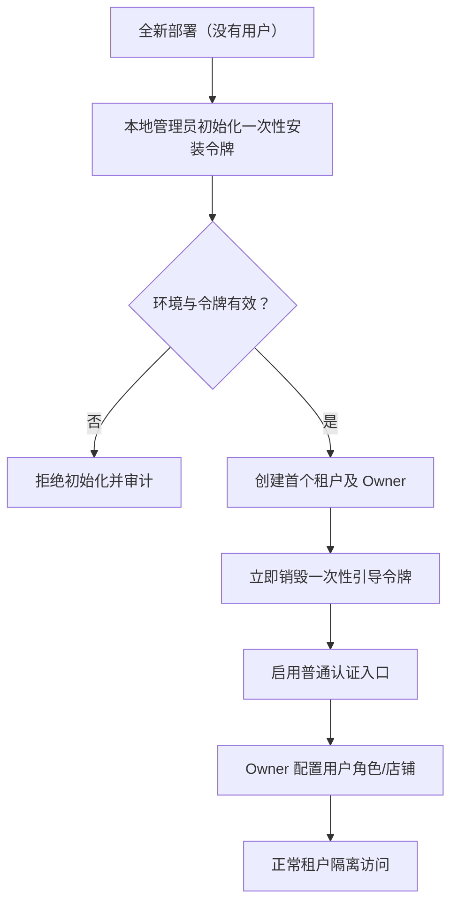

# IAM-001 · 首次安装、账号认证与租户授权闭环

**状态：Proposed**；弥补 PRD 中「先创建管理员/组织」但没有明确初始化权限的缺口。

## 1. 首次安装引导

**安全边界**：不得出现硬编码默认管理员密码。初始化入口仅在首次安装、受本地/受限网络和一次性随机安装凭证保护；首次初始化成功后永久关闭，恢复只能走独立受审计维护流程。

## 2. 身份与角色草案

- 用户在一个/多个租户的成员关系必须显式声明；角色属于具体租户，系统拥有者与业务租户管理员不同。
- 会话内活动租户的切换由服务端验证成员资格，不能用 `X-Tenant-Id` 作为唯一授权来源。
- 后台任务保存不可变的 tenantId/accountScope/creator，Worker 恢复此上下文后执行授权校验；日志和导出对象的作用域一致。
- 用户退出/令牌失效，所有后续敏感 API 返回 401；无权访问同租户中的特定店铺资源也要返回不可见策略。

## 3. 授权矩阵核心要求

| 操作 | 系统初始化 Owner | 租户 Admin | 运营 | 财务 | 只读 |
|---|---|---|---|---|---|
| 首次初始化租户 | 仅一次 | 不可用 | 不可用 | 不可用 | 不可用 |
| 添加成员/授予店铺范围 | 不自动拥有业务权限 | 可以 | 否 | 否 | 否 |
| 保存/撤销店铺连接 | 无默认业务权限 | 可以 | 否 | 否 | 否 |
| 手动同步 | 无默认业务权限 | 可以 | 在范围内 | 否 | 否 |
| 录入商品成本 | 无默认业务权限 | 可以 | 否 | 可以 | 否 |
| 读取店铺数据 | 无默认业务权限 | 在范围内 | 在范围内 | 在范围内 | 授权范围内 |
| 访问明文密钥 | 不可用 | 不可用 | 不可用 | 不可用 | 不可用 |

## 4. 安全验收

首个管理员只能创建一次；无默认通用密码；跨租户成员切换安全；权限撤销后的会话刷新策略；异步任务不能提权或串租户；导出、对象存储与缓存同样隔离。选用本地用户/OIDC/MFA 的细节仍需决策（[Q12](../requirements/decision-questions.md)）。
