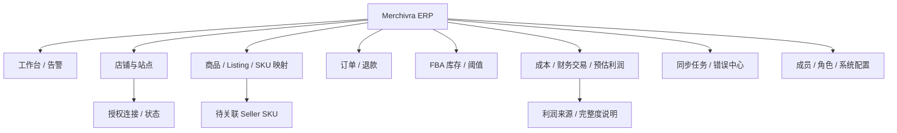

# UX-001 / UX-002 · 导航与页面状态参考

**历史设计参考（非现行实现清单）**。本文件合并早期低保真导航与页面状态矩阵，保留 UX-001/UX-002 需求追踪标识。实际 Next.js 页面以 [根设计规范](../../DESIGN.md)、[当前事实](../current-status.md) 和 [现行计划](../roadmap/current-plan.md) 为准。不得把原草图的页面、指标、移动端优先级或计划中的交付物解释成当前实现或批准决策。真实净利润未知，不因显示而确认。

## 导航与业务入口

历史线框保留于 [V237 精确 Git 原文](https://github.com/kunlong-luo/merchivra/blob/c6ef07a3250aa52922f35ae7ee2f075083c94047/docs/ux/navigation.md)，不再复制到现行设计文档。现行页面设计见 [Next 工作台](next16-command-center-visual-refresh.md) 与 [多工作区设计](next16-multi-workspace-polish-v178.md)。

## 页面状态矩阵（UX-002）

| 页面 | 正常 | 空/未配置 | 数据异常 | 权限失败 | 明确操作 |
|---|---|---|---|---|---|
| 工作台 | 账户/站点/周期/币种过滤 + 截止时间 | 进入连接向导或 Mock | STALE、PARTIAL、未归类费用 | 不显示未授权指标 | 查看来源、跳转问题 |
| 店铺 | 连接、Marketplace、角色范围 | 添加自有账户 | AUTH_REQUIRED / INSUFFICIENT_ROLE / DEGRADED | 禁止新增/删除 | 重试验证、撤销连接 |
| Listing | SKU、ASIN、映射版本 | 无 Listing | UNMAPPED / CONFLICT | 禁止映射编辑 | 关联、验证 |
| 订单 | 独立履约/退款/财务状态 | 无订单 | 同步延迟、映射缺失 | 隐藏敏感字段/导出 | 回钻行、财务来源 |
| 库存 | 最新快照与状态分桶 | NO_DATA | STALE / UNKNOWN / 真正 ZERO | 禁止跨站点查询 | 查看历史、设置提醒 |
| 财务 | 预估/已入账/结算三视图 | 无财务授权或尚无交易 | 未归类、缺少成本/汇率 | 隐藏利润/导出 | 查看差异、确认分类 |
| 同步中心 | Stream、run、attempt、checkpoint | 无任务 | 429 等待、授权撤销、分页重扫 | 拒绝他人任务范围 | 暂停/重试/查看证据 |
| 设置 | 成员/角色/日志 | 首次引导 | 密钥失效、权限不足 | 禁止管理入口 | 审计修改 |

## 总览与详情的交互约束

- 每张指标卡必须有 `口径 + 币种 + 截止时间 + 完整度`；不能用一个绿色数字掩盖未收集广告/税费。
- 站点切换不应无提示地更改币种；跨站点合计必须明确折算率。
- 异常状态拥有可执行出口：`关联 SKU`、`重试同步`、`查看权限`、`查看差异`，但需要角色授权。
- 同步状态显示“上次成功”“正在执行”“下次尝试”，区分平台 API 当前不可用与店铺凭证被吊销。
- 危险操作必须展示作用范围、二次确认和审计记录。

## UI 走查顺序

1. E2E-01：第一次安装能顺利进入 Mock。
2. E2E-03：订单详情可以同时看到 SHIPPED 与 PARTIAL_REFUND。
3. E2E-04：库存 ZERO / UNKNOWN / STALE 三态清晰。
4. E2E-05：利润面板避免双计，并展示费用未覆盖。
5. E2E-06：同步中心展示断点恢复、退避及异常证据。

详见 [API 契约](../architecture/api-contracts.md)、[业务场景](../testing/end-to-end-scenarios.md)。原 UX-002 完整历史见 [Git 原文](https://github.com/kunlong-luo/merchivra/blob/c6ef07a3250aa52922f35ae7ee2f075083c94047/docs/ux/page-state-matrix.md)。
