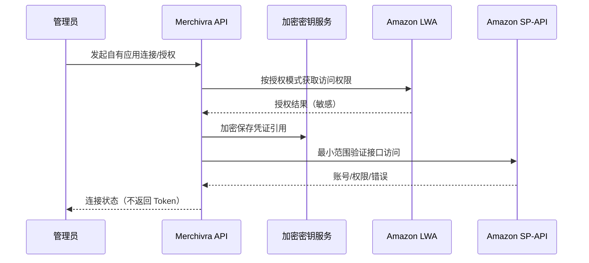

# INT-001 · Amazon SP-API 接入与权限说明

> 校对时间：2026-10-30。**本文件是设计参考，不代表项目已获开发者批准或 API 权限。** 正式实现前再次核对 Amazon 对应接口的最新角色、用量计划、版本及数据保护政策。

## 1. 私有应用 vs 公共应用

- **Private seller application**：仅面向自己的组织，按 Amazon 指定流程注册、自授权；专业卖家账户等资格与限制须核对。
- **Public seller application**：面向其他卖家，通过其认可的 OAuth 流程授权，需要完成相应注册、审核及 Appstore 要求。
- **GitHub 开源 ≠ Amazon 公共应用获批**。初期「开源代码 + 私人部署」应使用各部署主体合规获得的凭证或 Mock 模式；不能分享统一生产令牌。

官方注册：https://developer-docs.amazon.com/sp-api/docs/sp-api-registration-overview

## 2. P0 API 能力映射

| 领域 | 首选数据来源（需逐接口核对） | MVP 用途 | 限制 |
|---|---|---|---|
| Seller 连接 | LWA / SP-API authorization | 自有账户授权状态 | Developer / App 资格 |
| 订单 | Orders API **v2026-01-01**，`searchOrders` / `getOrder` | 订单与行数据 | 角色要求、区域与分页 |
| 商品目录 | Catalog Items API | ASIN 及目录信息 | 不是 Listing 唯一真相 |
| Listing | Listings Items API / Reports | Seller SKU 与上架信息 | 按卖家/Marketplace 作用域 |
| FBA 库存 | FBA Inventory API v1 `getInventorySummaries` | 库存状态快照 | 不等于仓库流水 |
| 财务 | Finances API **v2024-06-19** `listTransactions` | 财务事件、费用和支付核对 | Finance and Accounting 角色 |
| 批量报表 | Reports API | 适合批量数据/对账 | 异步生成/处理 |
| 消息通知 | Notifications API | 辅助低延迟同步 | 仍需定期补偿 |
| 广告（P1） | Amazon Ads API | 广告花费 | 独立申请/权限，不由 SP-API 自动覆盖 |

Orders 版本参考：https://developer-docs.amazon.com/sp-api/docs/orders-api  
迁移说明：https://developer-docs.amazon.com/sp-api/docs/orders-api-migration-guide  
Finances 参考：https://developer-docs.amazon.com/sp-api/docs/finances-api  
FBA Inventory：https://developer-docs.amazon.com/sp-api/docs/fba-inventory-api

## 3. 订单 PII 政策

Orders API v2026-01-01 支持 `includedData`；MVP 只请求实现商品、数量、状态及费用分析所需数据，**默认不包含 BUYER / RECIPIENT**。该版本 PII 授权要求改为基于角色，但不等于所有 SP-API 端点的 RDT 要求消失；特定受限接口仍需单独核对。未经审查不存储买家地址或身份数据。

## 4. 接入时序（逻辑）

**生产实现**必须遵循 Amazon 的具体注册和授权流程，此图不是可直接照搬的 OAuth 操作步骤。

## 5. 操作限流与安全

- 按操作+账号+应用维度管理 rate limit；优先遵循接口文档及响应中的有效限制信息，不写死统一频率。
- 处理 429、5xx、超时，支持 Retry-After（若响应含此信息）、指数退避和重试上限。
- Token 不出现在 UI、日志、Issue、测试固定样本；访问密钥、轮换和撤销全链路记录审计事件。
- API 的返回可能不完整或迟到；同步视图必须显示更新时间，财务需要重对账。
- 禁止默认申请不必要的 Restricted roles；数据保留和删除遵守 Amazon 适用政策。

## 6. 接口验收前准备清单

- [ ] 确认目标 NA / EU / FE 区域与 Marketplace ID。
- [ ] 确认应用注册类型、角色、沙箱和生产审核情况。
- [ ] 为每个 API 固定版本/operation/角色/限额/错误样例到映射表。
- [ ] 在没有真实账号时用虚构 Mock 数据做契约测试。
- [ ] 在允许的真实试点验证订单、FBA 和财务数据一致性。
- [ ] 确认敏感字段最小化与 Amazon DPP / AUP 约束。

官方入门：https://developer-docs.amazon.com/sp-api/docs/onboarding-overview
