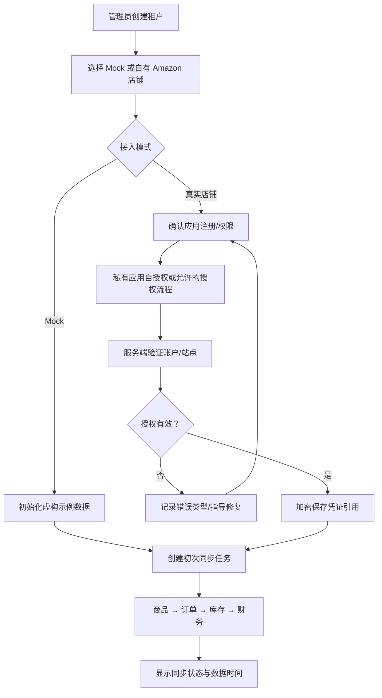
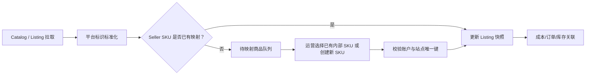
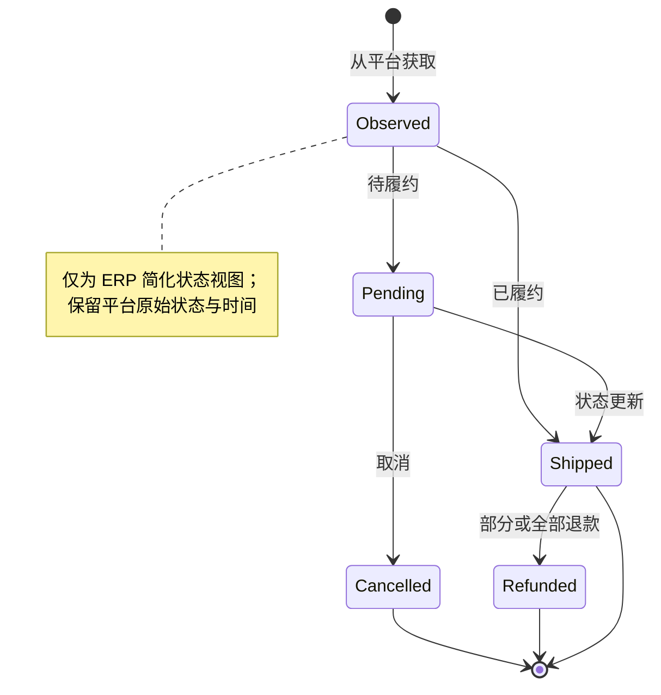
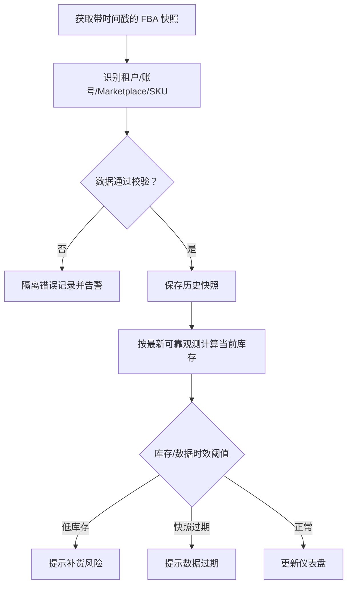
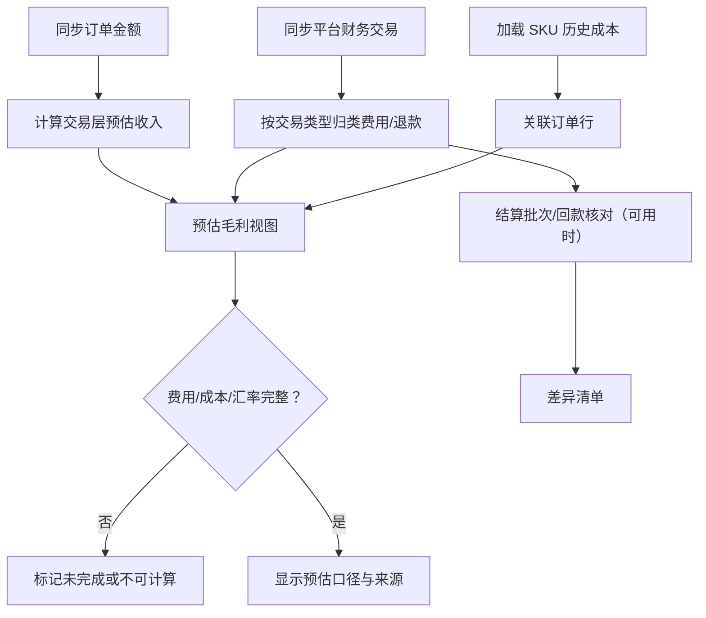

# BIZ-001 · 核心业务流程图

**图纸性质：业务流程草案。** 所有外部平台数据处理都受 Amazon 许可、访问角色和业务范围约束。

## BIZ-01 店铺接入（私有应用优先）

**控制点**：用户不能直接提交任意租户 ID；连接失败不得记录明文 Token；站点范围经授权校验。

## BIZ-02 商品从平台到 ERP 的映射

**关键例外**：同一 ASIN 存在不同变体、包装、账号 Seller SKU；缺失映射不可静默归属错误的内部 SKU。

## BIZ-03 订单生命周期与退款

**注意**：退款、付款、结算可在订单生命周期之外异步发生，不要求与订单状态严格同步。

## BIZ-04 FBA 库存对账

**控制点**：快照覆盖当前观测，绝不当作增量库存流水；站点、所有权和状况分桶明确。

## BIZ-05 财务核对

**业务审批点**：业务负责人必须先确认计算口径，系统不能将广告未纳入的毛利命名为净利润。
