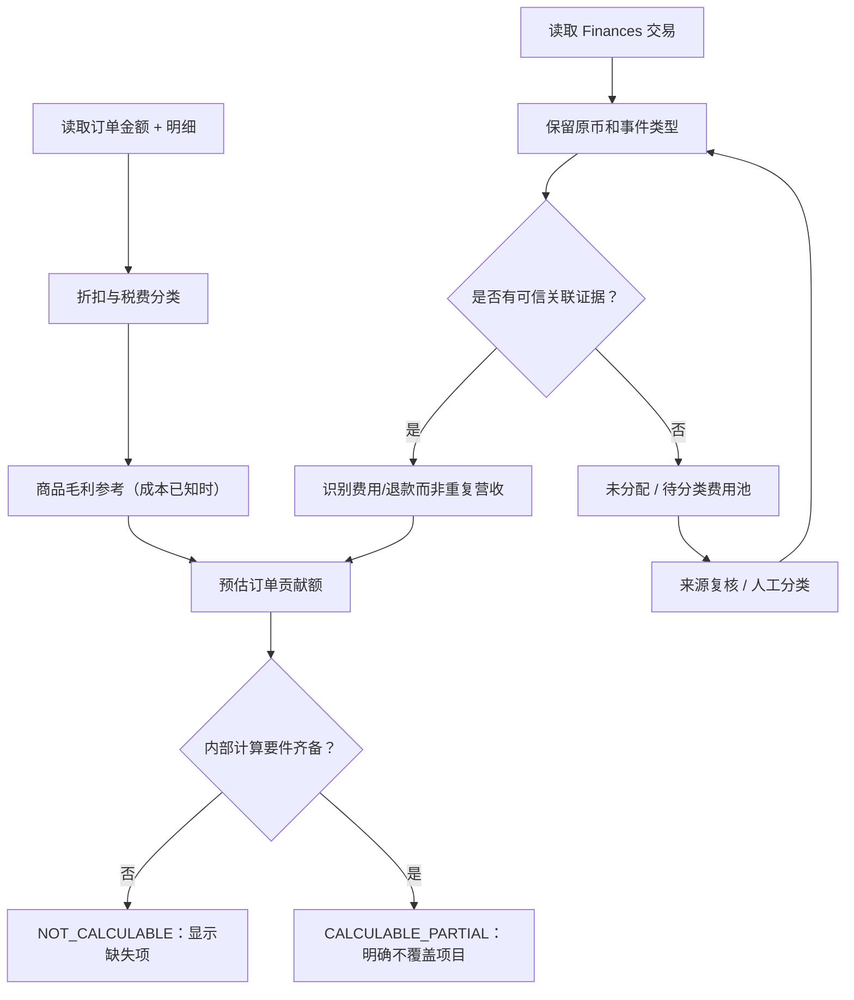

# BIZ-005 · 费用分类、退款与利润指标业务口径表（G1 候选）

**状态：Proposed / DEC-06、DEC-07、DEC-08 仍待财务/卖家批准**。本文件定义产品展示含义，不是会计报表、税务或 Amazon 已保证提供这些字段的承诺。

## 1. 先统一三个核心概念

| 指标 | 建议定义 | 可以做什么 | 不能叫什么 |
|---|---|---|---|
| 折后商品销售额（Order provisional） | 商品销售金额－被识别的商品折扣－已确认归属商品的销售退款 | 按订单发生期展示经营变化 | 平台实际到账金额 |
| 商品毛利参考值 | 折后商品销售额－已知对应商品 COGS | 只在成本确定时展示，不包括平台/物流/广告等费用 | 净利润 |
| **预估订单贡献额** | 商品毛利参考值－已识别平台销售费用－已识别履约费用＋已分配可归属调整（以有证据的分类为准） | 用于 SKU/订单已知费用范围的经营决策；显示完整度 | 完整净利润、会计营业利润 |
| 平台已入账金额 | 按 Finances 交易及其类型、入账时间归类的金额 | 核对订单层预计和平台记录 | Orders 金额直接累加项 |
| 平台结算/支付金额 | 依官方可用结算/释放/支付关联计算 | 结算/回款对照 | 销售额或业务利润 |

**术语修订建议**：旧文档的“预估贡献毛利”建议逐步统一为“**预估订单贡献额（已知费用范围）**”，避免“毛利”与已扣平台费用的指标混淆。需要 DEC-07 认可后全局更名并固定翻译。

## 2. 费用/收入分类矩阵

| 来源类别（业务抽象，不假设 API 原字段名） | 预估经营收入 | 商品毛利 | 预估订单贡献额 | 平台入账视图 | G1 边界 |
|---|---|---|---|---|---|
| 商品销售金额 | 计入 | 计入 | 计入 | 财务事件归类后独立显示 | 按商品订单行 |
| 商品折扣/促销 | 负向影响 | 负向影响 | 负向影响 | 由可验证交易/调整单独展示 | 避免折扣重复计算 |
| 商品退款 | 按可归属的销售部分扣减 | 同上 | 同上 | 根据退款/冲销事件 | 税/运费部分先分类 |
| 订单向买家收取的运费 | 依确认口径单独列示 | 待决定 | 只有归属明确才计入 | 依事件归类 | 不推断卖家实际运费 |
| 平台销售佣金 | 不作为销售收入扣除 | 不扣 | 扣除已知费用 | 在财务事件中归类 | 非源费用未知不能按 0 |
| FBA 履约费用 | 不作为销售收入扣除 | 不扣 | 扣除已知费用 | 在财务事件中归类 | 仅 FBA 可归属订单 |
| FBM 商家发货实际成本 | 不作为销售收入扣除 | 不扣 | 费用真实存在且已知才扣 | 外部输入或导入（P1） | MVP 缺少时 PARTIAL |
| 采购成本（COGS） | 不扣 | 扣 | 扣 | 作为 ERP 内部成本关联，不直接当平台财务事件 | 生效版本不可覆盖历史 |
| 广告花费 | 不扣 | 不扣 | MVP **不包含** | 独立 Ads API，P1 | 必须标“未覆盖” |
| FBA 仓储/头程/供应链 | 不扣 | 不扣 | MVP 默认未分配 | 可归类待分配费用 | 不伪造 SKU 分摊 |
| 代收代缴税/卖家税费 | 必须先区分所有权 | 依合法口径 | 需另行审核 | 保留来源类型 | 不做税务会计结论 |
| 赔偿/调整/其他服务费 | 未必属于销售 | 不默认计入 | 有证据才分配 | 保留未归类项 | 不自动当商品收入 |
| 汇兑损益/银行手续费 | 不扣 | 不扣 | P0 不默认分配 | 回款对账依实际来源 | P1 或单独视图 |

## 3. 状态判定规则

- **CALCULABLE_PARTIAL**：所声明公式需要的所有字段齐备，但广告/头程等未覆盖。可以展示预估订单贡献额，但必须显示“已知费用范围”。
- **NOT_CALCULABLE**：公式内部的必要项（如成本版本或必要的费用值）缺失，不得显示完整的金额型贡献额；可展示原始收入和已知成本。
- **UNMATCHED**：有财务事件但不能证明属于哪个订单/行，保留在单独的“未分配财务事件”列表。
- **STALE**：平台数据超过业务时效阈值；最新金额不可当成实时数据。
- **DISPUTED**：核对差异或来源冲突；展示金额同时给出差异证据，不静默修正。

“缺失”和“明确为 0”不同。用户手工录入 0 费用时必须记录来源和确认人，不能用默认值 0 掩盖缺失的财务事件。

## 4. 财务事件归属流程

## 5. 退款与成本处理

- **部分退款**：只能把可证实属于商品销售收入的部分减少预计经营收入；税费和运费返还独立分桶。FBA/平台手续费返还只有来源事实时才冲销。
- **退货入库**：订单退款本身不证明库存已经回归可售；COGS 的退货冲回须依据明确的业务/仓库事件与会计口径（MVP 暂不自动冲回）。
- **跨期退款**：订单经营视图可以按原订单回算并展示最新认识；财务视图按退款交易实际入账期；同时保留“原计算版本”与“当前计算版本”，防止历史报表突然变化但无人知晓。
- **净额源数据**：如果平台只提供一个已包含费用的交易净额，必须先识别明细构成才能再减费用，不能重复扣减。

## 6. 汇率与舍入

MVP 原币种计量。跨币种汇总应在 DEC-08 确认 `baseCurrency`、`rateSource`、`rateDatePolicy`、`roundingMode`、精度及适用业务时间轴后才开放；不存在未经标记的“美元等值”自动换算。

## 7. 待批准和后续补件

1. 是否将主要报表指标命名“预估订单贡献额”而不是“毛利”？(DEC-07)
2. 收入/运费收入与税费所有权的精确定义？(DEC-07)
3. 退货 COGS 是否冲回，何时冲回，按什么证据？(DEC-06/07)
4. 未能匹配订单的仓储费等是否只展示为“未分配”，而不分摊到 SKU？(DEC-07)
5. 跨币种政策、日期政策、汇率提供者和精度？(DEC-08)
6. 哪些“已知平台费用”是 P0 公式必备项，何种情况下允许“未完成”贡献额？

[虚构金额算例](business-scenarios.md) · [既有 FIN 设计](../architecture/finance-model.md) · [财务来源对账](../architecture/source-reconciliation.md)
