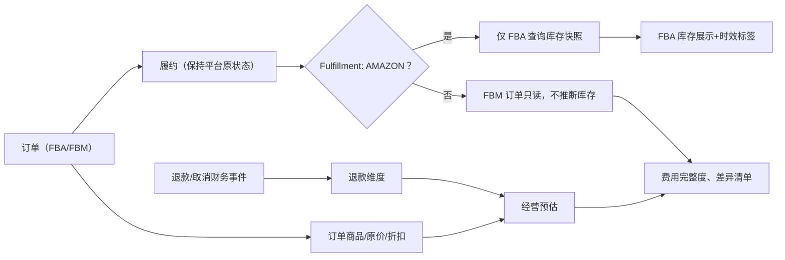

# BIZ-002 · 美国站 FBA / FBM 业务边界与状态行为

**状态：Proposed**；建议试点美国站（Marketplace US，接入 NA region；实际账户授权和 Marketplace ID 接入时验证）。FBA 库存业务优先、FBM **订单只读**，不宣称管理 FBM 实物库存。

## 1. FBA / FBM 能力矩阵

| 功能 / 场景 | FBA P0 | FBM P0（候选） | P1+ / 不在 MVP |
|---|---|---|---|
| 读取卖家订单/订单项 | 支持 | 支持（只读） | 修改履约/发货 |
| 订单履约渠道标识 | Amazon | Merchant | 自动发货履约 |
| 订单状态、退款关联 | 保留平台事实 | 保留平台事实 | 自动处理退款申请 |
| FBA 库存按桶快照 | 支持 | **不适用** | 国内仓/FBM 台账及盘点 |
| 低库存提醒 | 依据 FBA 有效快照 | 不提供“FBM 缺货”推断 | 采购/补货建议 |
| 商品 Listing/SKU 映射 | 支持 | 支持 | 批量刊登、改价 |
| 成本/利润估算 | 在字段可得时 | 在费用已知时 | 完整利润/税务 |
| FBA 配送费用 | 财务事件可用时识别 | 不适用 | 头程/仓储分摊 |
| 卖家自发货运费支出 | 不适用 | 没有来源时为 UNKNOWN | FBM 物流商/面单集成 |
| 标签、发货、跟踪回传 | 不提供 | 不提供 | 需单独权限/业务设计 |

## 2. 三条并行时间轴

- **订单**：平台创建/更新、履约、取消；保持原始状态，并可显示内部映射后的视图，不以退款覆盖履约。
- **退款**：一笔或多笔财务退款、优惠调整或补偿；和订单状态并行，可能先于订单同步。
- **财务**：平台 transaction posted / 结算关联 / 回款，这些时间与订单发生时间不同。

报告默认展示“按订单发生时间”的经营视图和“按交易入账时间”的财务视图，不能将时间范围不一致的两个总额直接比作差异。

## 3. FBA 库存决策表

| API 数据 | 页面值 | 是否可触发缺货提示 |
|---|---|---|
| 成功取得可售数量 0，且在时效阈值内 | `0` + 观测时间 | 是（按阈值规则） |
| 成功取得可售数量 12，且未过期 | `12` + 观测时间 | 依据阈值 |
| 可售字段未返回或无有效快照 | `UNKNOWN` | **否**，提示未取得数据 |
| 上次有效快照过期 | `STALE (历史值)` | 不作为实时缺货判断 |
| 不同 FNSKU/condition/disposition | 分维度展示 | 不跨桶粗暴合并 |

P0 不处理仓库调拨与盘点，这两者属于内部物理库存台账。前端不得出现「FBA 库存=FBM 库存」的总量。

## 4. 状态与退款业务说明

## 5. 验收所需例外

FBA 未返回库存、FBM 有订单而没有库存、部分退款但已发货、促销折扣、后到的订单更正、跨站点同 SKU、没有 Finances 权限。这些情况不能默认显示 0 库存或“完整净利润”。

## 6. 外部接口来源

官方 Orders v2026-01-01 支持新的 fulfillBy/fulfillmentStatus 语义（需按具体响应字段校验）；FBA Inventory v1 提供 fulfillable/inbound/reserved/unfulfillable/researching 等状态。操作级字段与角色见 [INT-002](../integrations/sp-api-operation-matrix.md)。**官方能力不等于此应用已获批准权限。**
