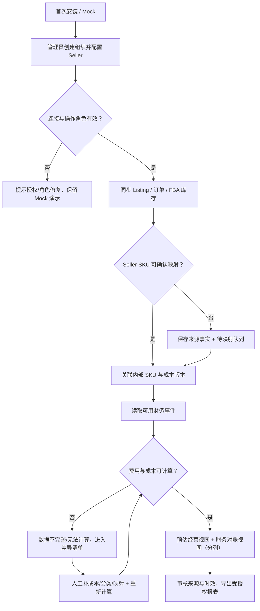

# G1-001 · 第三轮产品业务评审包（US / FBA 优先）

**文档状态：Proposed，不代表用户已批准。** 评审范围：目标卖家、首发站点、履约范围、SKU、成本、收入与利润。**本轮不启动编码，不冻结 G2 架构。**

## 1. 本轮希望达成的结果

1. 选择一个可审查的**首发场景**：建议 1 个卖家账户 + 美国站 + FBA 订单与库存 + FBM 订单只读。
2. 固定 P0 / P1 / 不做的边界，减少“报表看起来完整”而数据不完整的风险。
3. 用一组不含真实经营数据的可手算订单核对折扣、费用、退款、成本与结算。
4. 给出 SKU 归属冲突、费用缺失、接口权限缺失、历史数据修正时的处理规则。
5. 给每个关键业务选择一个 DEC 编号与一个可重复的验收场景，不把建议默认转为“已通过”。

## 2. 建议首发画像（非用户事实）

| 项目 | 建议基线 | 替代选项 | 影响 | 决策 |
|---|---|---|---|---|
| 开源用户 | 自托管 Amazon Seller，小运营团队 | 立刻做多租户 SaaS | 安全、授权及部署责任 | DEC-01 |
| 首站 | US / NA | US+EU/JP 同时首发 | 时区、币种、接入和测试复杂度 | DEC-02 |
| 试点规模 | 1 个自有 Seller、1 个 Marketplace | 多站多账户实测 | 同步回填与压测 | DEC-02、DEC-14 |
| 履约 | FBA 订单+库存，FBM 订单只读 | FBM 库存和发货全管理 | API 角色、仓库台账、物流流程 | DEC-03 |
| SKU | 内部 SKU + Seller SKU/ASIN/FNSKU 分离，人工确认歧义 | 以 ASIN 为唯一产品 | 多变体、捆绑与历史归属问题 | DEC-05 |
| 利润 | **预估贡献毛利**，非净利润；财务数据单独对账 | 第一版就算完整净利润 | 成本/广告/头程/税费数据依赖 | DEC-06/07 |
| 汇率 | 原币展示，跨币种合计暂禁用 | 自动换汇 | 来源、日期与舍入规则 | DEC-08 |
| 首发语言 | UI 中文，文档中英入口 | UI 中英双语同时完整 | i18n 及文案验证 | DEC-15 |

## 3. P0 产品业务范围说明

**包括**：账户连接状态、Marketplace 过滤、Listing/SKU 映射、FBA+FBM 订单读取及订单行、FBA 库存快照、有效期成本录入、财务流水与费用分类、预计/已入账/结算分列视图、差异清单、可追踪报表、Mock 演示。

**不包括**：FBM 发货标签/物流跟踪编辑、仓库出入库台账、向 Amazon 写库存/改价/刊登、FBA 入仓计划、采购单、广告数据接口、税务申报、自动回款匹配银行流水、一般会计总账。若首发用户不需要 FBM 订单，亦可将其从 P0 读入范围移到 P1——需 DEC-03 确认。

**诚实降级**：没有 Finances role 时仍可展示 Orders 预计经营数据，但已入账/结算视图必须显示“未授权或不可用”，不可用人为零值替代；缺少商品成本则该订单的金额型毛利为“不可计算”。

## 4. 端到端用户任务（成功 + 异常出口）

说明：上图是**业务交互**而非技术同步顺序承诺；后到数据应可补偿。对“授权不可用”和“费用缺失”分别记录不同原因。不能把映射缺失强制阻断事实入库。

## 5. G1 决策会建议议程（60–90 分钟，仅流程建议）

- 10 分钟：确认目标用户、首站和账户规模。
- 15 分钟：走查 FBA/FBM 业务边界和订单/库存状态。
- 15 分钟：确认 SKU 编码、变体、捆绑与映射冲突规则。
- 25 分钟：拿 [虚构订单账例](business-scenarios.md) 核对收入/折扣/退款/成本/费用，区分预计、已入账和结算。
- 10 分钟：对 [待批准选项](../governance/decision-register.md) 逐项选择；无法回答保留待验证、明确责任人。
- 10 分钟：确认下一步 G2 物理模型/授权所需材料。

## 6. G1 退出标准

| 条件 | 证据 | 状态 |
|---|---|---|
| DEC-01/02/03/05 已有产品负责人明确选择 | Issue 评论或记录的业务决定 | 待批准 |
| DEC-06/07/08 成本与利润至少有 1 个手工复核实例 | 财务确认算例、费用分类表 | 待批准 |
| FBA/FBM 范围与 P0 功能一致 | [履约范围表](fulfillment-scope.md) | 设计稿 |
| 可复现来源→映射→费用→展示→差异→修正闭环 | [业务样本](business-scenarios.md)、[验收](../requirements/g1-business-acceptance.md) | 设计稿 |
| PRD / FR / AC / 风险追踪同步 | [PRD](../requirements/mvp.md)、[RTM](../requirements/traceability.md) | 待复查 |
| 评审结果与剩余风险由责任角色签署 | [G1 评审记录](../governance/g1-review-2026-10-30.md) | 待签署 |

**G1 未批准之前，所有示例数据、币种口径和首发范围均为候选。**
