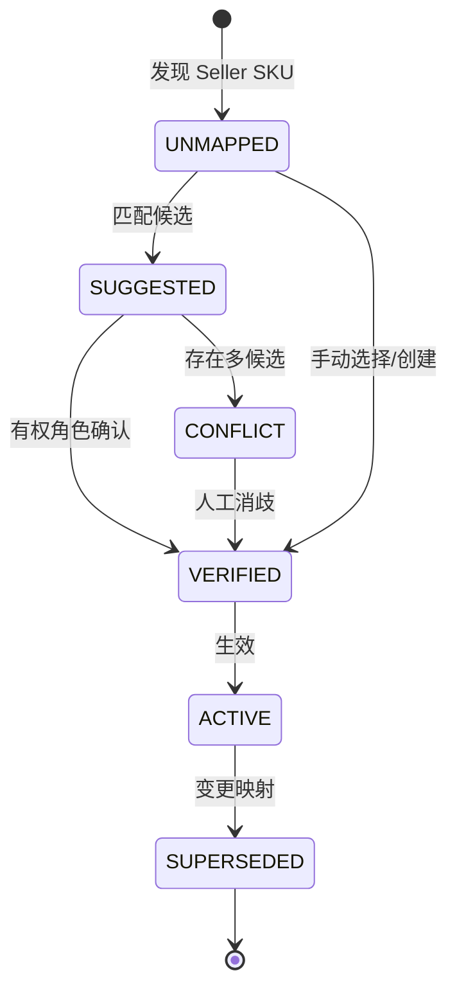

# BIZ-003 · 内部商品、Seller SKU、ASIN、FNSKU 与历史归属业务策略

**状态：Proposed**。业务目标：同一产品在不同账号/站点有不同 Listing，仍能统一分析；保留原始外部标识，映射失败不得丢订单或库存。

## 1. 标识术语

| 标识 | 所属系统与范围 | 示例（虚构） | 可以用作内部全局主键吗？ |
|---|---|---|---|
| internal SKU | Merchivra / tenant 内唯一 | `MV-CUP-BLUE-01` | **不能跨租户直接当全局键** |
| seller SKU | Seller + Marketplace 下的卖家商品编码 | `AMZ-US-CUP-B` | 否；至少连同账号与站点 |
| ASIN | Amazon 商品目录标识 | `ASIN_MOCK_BLU` | 否；可关联多个 Listing |
| FNSKU | FBA 库存标识 | `FNSKU_MOCK_X` | 否；只作为可选来源字段 |
| external order item ID | 订单项来源标识 | `LINE-MOCK-001` | 否；结合订单与平台作用域 |

**父商品/变体**：MVP 可保留 parent/child 结构字段，但利润和库存最终关联可销售**变体 SKU**。捆绑商品、套装、多包装、赠品等拆件 BOM 逻辑作为 P1 待评审；无法确认时显示待归属，不假设一件等于一个库存单位。

## 2. 映射规则优先级（严格）

1. 有效且经确认的 `tenant + sellerAccount + marketplace + sellerSKU + valid_time` 映射优先。
2. 只有一个明确候选且满足约束时可自动建议，**不得未经确认自动并入**。
3. ASIN、标题、FNSKU 或相同图片仅用作**候选证据**，不能独自覆盖人工核准映射。
4. 冲突时把事实保存到 `UNMAPPED/CONFLICT` 队列；订单项原始 sellerSKU 不因后续映射而丢失。
5. 映射更改生成新版本：包含生效时间、修改人、原因、来源映射及影响的历史投影；只对明确的回算范围重新计算。

## 3. SKU 生命周期

当源 Listing 删除、账号断开或商品停售，ERP 不应自动删除业务历史。旧映射可 `SUPERSEDED` 或 `INACTIVE`，而不是复用同一记录覆盖先前业务事实。

## 4. 典型冲突例子

| 事件 | 正确行为 | 禁止行为 |
|---|---|---|
| 同 ASIN 在店铺 A/B 各有 Seller SKU | 两条 Listing 可映射同/不同内部 SKU | 只凭 ASIN 自动合并 |
| 同一 Seller SKU 改包装/规格 | 产生映射审核，记录生效日 | 直接替换历史采购成本 |
| 内部 SKU 停售，旧订单仍存在 | 保留旧 SKU 与相关订单 | 硬删除造成财务明细断链 |
| 批量导入发现重复内码 | 同租户冲突拒绝、提供行号 | 静默覆盖旧产品 |
| 某 FBA 观测先于 Listing | 保存来源数量、时间、状态桶 | 因无内部 SKU 而忽略观测 |

## 5. 回算与审计

对修改映射的可追溯记录包括 `previousMappingId`、`newMappingId`、`validFrom`、`operator`、`reason` 和受影响的预估报表区间。新映射可以影响查询投影，但不能篡改订单中来源 seller SKU 或平台交易原币数据。

## 6. G1 未决

- 内部 SKU 是否已经存在以及命名规范；
- 多件套/BOM、变体、SKU 重命名和拆分是否属于首版真实需求；
- 费用分摊单位是独立 SKU、订单行还是变体组；
- 回溯重算是否必须人工二次确认。

参见 [DEC-05](../governance/decision-register.md)、[G1 场景](business-scenarios.md)。
