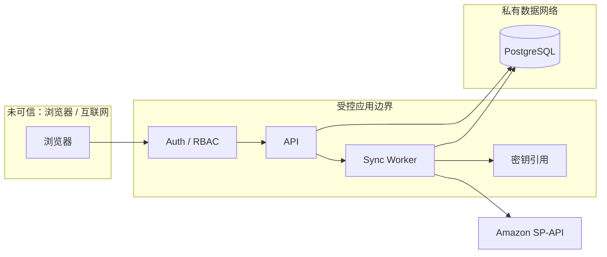

# SEC-001 · 权限、隐私与威胁模型

**状态：安全设计草案。** 在完成认证、租户隔离、密钥保护和安全测试之前，工程骨架不得对公网开放，不得引入真实客户数据。

## 1. 关键资产与威胁

| 资产 | 主要威胁 | 必须实施的控制 |
|---|---|---|
| LWA Refresh Token / app secrets | 泄漏导致越权读取卖家数据 | 加密存储、机密管理、最小权限、轮换、禁止回显 |
| 订单/库存/财务事实 | 跨租户查询、恶意修改、删改记录 | 强制 tenant context、审计、不可变财务流水 |
| 买家 PII | 误收集、日志泄漏、长期保存 | 默认不采集、最小必要、保留/删除机制 |
| API / 账户会话 | 弱口令、会话劫持、CSRF/授权绕过 | 安全认证、会话生命周期、CSRF 与速率防护 |
| 导出报表 | 未授权下载、共享链接泄漏 | 导出权限、限时链接、审计、脱敏 |
| 同步 Worker | 任务串租户、重复写入、配额耗尽 | 任务租户不可变、幂等、限流、租约隔离 |
| CI / 仓库 | 凭证误提交、供应链污染 | Secret scanning、依赖审查、最小权限 CI |

## 2. 信任边界

浏览器不应携带或接触 Amazon 的长期 Refresh Token；API/Worker 只接受经过授权的租户作用域。

## 3. 安全验收

- 默认拒绝权限；所有敏感数据按租户、角色、资源三维控制。
- API 负例：水平越权、越租户、导出越权、重放任务读取他人状态。
- 密钥：加密静态存储、机密轮换、访问审计、无明文日志；密钥服务不可用时安全失败。
- Web：安全 Session/Cookie 属性、CSRF、XSS、注入、上传文件校验、限流。
- 数据库：迁移账号与运行账号权限分离（生产）；备份加密、恢复演练、审计保留。
- 开源：漏洞私密报告渠道、依赖更新流程、禁止在 PR、截图、Issue 放真实客户信息。
- Amazon：在实施前按最新 Acceptable Use Policy / Data Protection Policy / Solution Provider Agreement 复核。

## 4. 暂不确定

身份提供方（本地账号、OIDC）、强制 MFA、PII 具体保留期限、数据驻留要求、部署安全基线；需在正式生产使用前评审。
