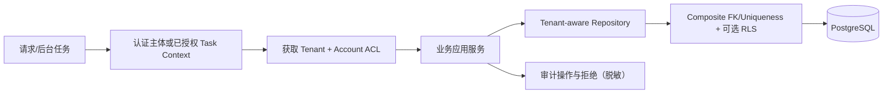

# SEC-002 · 服务端租户与资源授权执行规范（G2 候选）

**状态：Proposed；不是已生效安全功能。** 深化 [IAM-001](../architecture/tenant-bootstrap.md) 与 [ADR-0002](../architecture/adrs/0002-tenancy.md)。

## 1. 最低权限原则

用户会话明确 `actorId` + `activeTenantId` + `grantedAccountScopes` + `roles`。会话只能使用已认证关联的成员关系，不能因为请求里出现 `tenantId`、`sellerAccountId` 就推断授权。

| 场景 | 必须校验 | 失败策略 |
|---|---|---|
| 订单 GET /orders/{id} | 用户属于 tenant；订单属于 tenant；账号/Marketplace 在授权范围 | 返回不可见（禁止资源枚举） |
| SKU 映射修改 | tenant + 同店铺/Listing 范围 + 运营/Admin 权限 | 403/404 + 审计 |
| 财务成本写入 | tenant + 角色 Financial/Admin + SKU 范围 | 禁止未授权写入，历史成本不能被覆盖 |
| 同步触发 | tenant + Seller 账户操作权限 | 防重复 run / 跨租户任务 |
| 同步 Worker | 任务固定 tenant/account + 可追踪服务权限 | 不接受外部消息覆盖 tenant |
| 导出 | tenant + 明确角色/账号范围 | 审计导出范围、删除临时文件 |
| 缓存 | tenant + account + resource scope 前缀 | 不缓存跨租户可见的结果 |

## 2. 越权防御路径

**要求**：认证授权在 API/Service/DB 至少双层实施。可选 RLS 是附加层，不代表任何登录用户都可直接访问数据库。

## 3. 数据库隔离设计

- `(tenant_id, account_id)` 复合外键验证账号所有权；order/item/finance/observation/sync 各有 tenant_id。
- 对请求查询的 `tenant_id` 来自服务端 Session/Worker context，数据库 Repository 强制过滤；失败不退回全表查询。
- 如果最终使用 PostgreSQL RLS，连接池必须确保上下文不会串到下一租户，事务作用域设置/恢复并有集成测试。
- 管理员可以管理自己租户的 Seller 连接，但任何人不得读取原始 refresh token。
- 首次 Owner 初始化需要一次性随机引导令牌和重复初始化拒绝；不允许公开默认管理员密码。

## 4. 负面测试矩阵

| Test | 攻击/异常 | 预期 |
|---|---|---|
| SEC-T01 | Tenant A 请求 Tenant B 的订单 UUID | 无数据泄漏，不暴露订单存在 |
| SEC-T02 | 同租户运营访问不被授权的 Seller Account | 服务端拒绝 |
| SEC-T03 | 请求体传 `tenantId=B` 并期望越权 | 服务端忽略/拒绝外部 tenant |
| SEC-T04 | 背景任务的 account 不属于持久 tenant | DB FK 或 Service 不允许入库 |
| SEC-T05 | 在共享连接池换租户后复用 DB Connection | 没有先前租户内容 |
| SEC-T06 | 财务用户访问原始 Seller Token | 不可能读取或返回 |
| SEC-T07 | 无权只读角色尝试下载利润数据 | 拒绝导出并记录审计 |
| SEC-T08 | 跨租户命中相同 Redis key | 不返回他人缓存结果 |
| SEC-T09 | 重新初始化拥有默认 Owner 口令 | 阻止且记录安全事件 |

## 5. 待评审

身份提供方、JWT vs Cookie session、MFA、RLS 是否列为生产硬性标准、日志/缓存数据留存与删除期限。它们依赖 DEC-04/09/11，必须在真正实现认证前经过安全审查。
