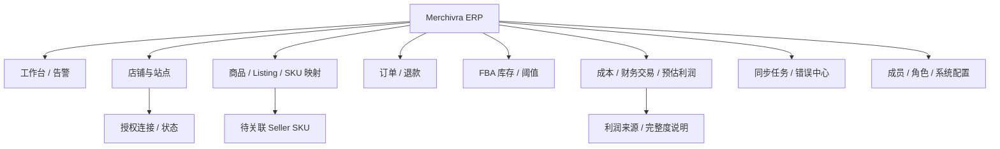

# UX-001 · UI 信息架构与线框草图

> **低保真设计**；尚非视觉稿，也没有承诺已实现。布局供产品评审，可由设计师使用 Figma 二次深化。

## 1. 页面地图



## 2. 工作台布局（桌面）

```text
┌────────────────────────────────────────────────────────────────────────┐
│ Merchivra     [组织] [卖家账户 ▼] [站点 ▼]       [同步状态] [用户]   │
├─────────────┬──────────────────────────────────────────────────────────┤
│ 工作台      │ 统计周期 [近7天▼]  币种 [USD▼]   数据截至 [时间]      │
│ 店铺        │ ┌──────────┐ ┌──────────┐ ┌───────────┐             │
│ 商品        │ │订单金额  │ │FBA低库存 │ │预估毛利*  │             │
│ 订单        │ └──────────┘ └──────────┘ └───────────┘             │
│ 库存        │ [趋势/站点对比图]   [任务异常 / 数据过期告警]          │
│ 财务        │ [SKU排行]           [未映射 SKU / 未分类费用]         │
│ 同步任务    │ *指标旁显示口径、币种与缺失数据说明                  │
│ 设置        │                                                      │
└─────────────┴──────────────────────────────────────────────────────────┘
```

## 3. 订单列表

```text
[账户▼] [站点▼] [日期范围] [状态▼] [Seller SKU 搜索] [导出]
┌─────────────┬─────────┬──────────┬──────────┬──────────────┐
│ 订单号       │ 站点    │状态      │ 原币金额  │数据更新时间   │
├─────────────┼─────────┼──────────┼──────────┼──────────────┤
│ Mock-0001   │ US      │Shipped   │ USD 40.00 │2026-10-xx    │
└─────────────┴─────────┴──────────┴──────────┴──────────────┘
详情抽屉：订单行 → SKU 映射 → 平台事件 → 成本版本 → 财务关联
```

## 4. 关键交互原则

- 一切聚合/报表均展示筛选范围、币种、同步水位和数据完整性。
- 未授权/空数据/同步失败要有不同状态，不显示误导性的零值。
- 订单详情默认不展示买家敏感信息；不同角色仅出现被授权操作。
- 危险操作（撤销连接、重新同步大时间段、修改成本）明确确认和审计。
- P1 再考虑移动端深度适配；MVP 首先保障桌面浏览器主业务路径。

## 5. 后续 UX 交付物

需要在 G1 之后补充 Figma 组件库、页面状态矩阵（正常/加载/空/权限/错误）、桌面页面高保真图、交互标注和多语言文案表，不在未确认业务流程前设计“最终版”页面。
